# DS01 · 纵深调度版｜第19—20集

参考脚本4:51。采用最新站位图V2，11批、17组，每组1张九宫格。以下为轻量JPEG预览，PNG原图与完整分镜原文在下载包中。所有图仍为审核稿。

## [点击下载全部17张PNG与分镜说明](https://github.com/liu-ai-cmd/LIU/raw/refs/heads/storyboard-downloads/DS01.zip)

尾组按已确认规则保留空格；受伤与划掌采用克制表达；原镜43/45的收手关系和镜98边界矛盾处理见包内注记。B06-G03采用工具近似画幅，未拉伸，未称为精确21:9。远景人数与遮挡肢体不作精确验证。

## B01-G01｜长城巡航与主阵眼试拔

原镜1—9；有效9格，留空0格。

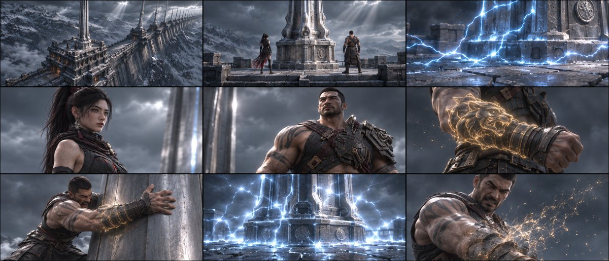

## B01-G02｜试拔受挫与金沙初显

原镜10—18；有效9格，留空0格。

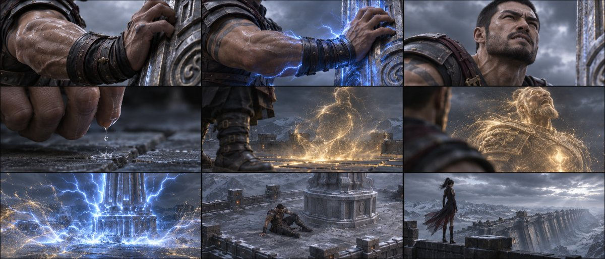

## B01-G03｜玄初敕令破阵

原镜19—26；有效8格，留空1格。

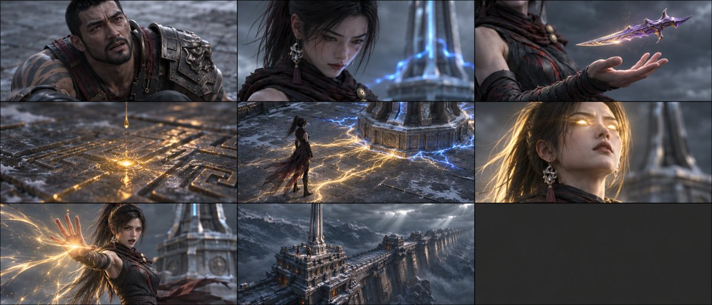

## B02-G01｜蒙战显化报名

原镜27—29；有效3格，留空6格。

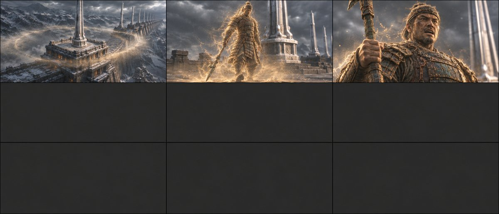

## B03-G01｜魏无忌显化报名

原镜30—31；有效2格，留空7格。

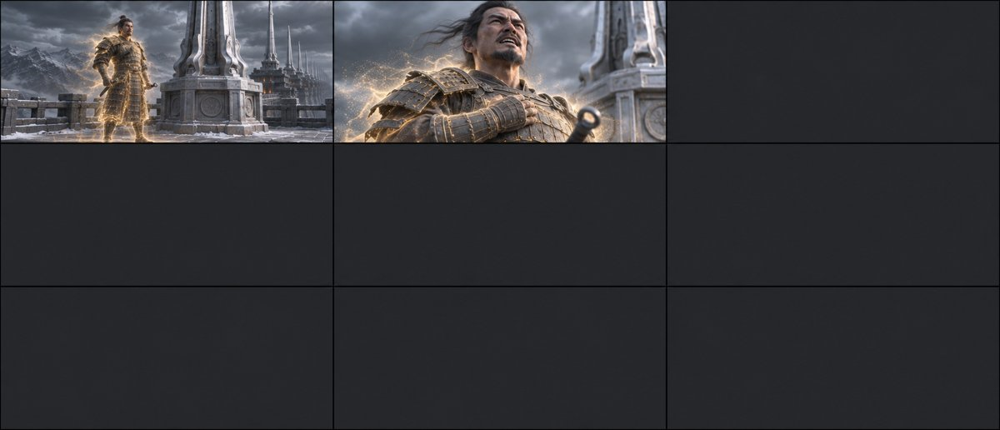

## B04-G01｜李广张弓报名

原镜32—34；有效3格，留空6格。

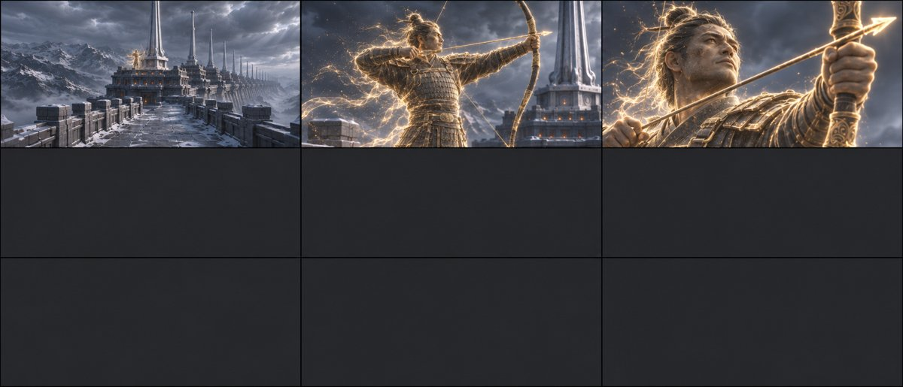

## B05-G01｜八十英灵成线

原镜35—37；有效3格，留空6格。

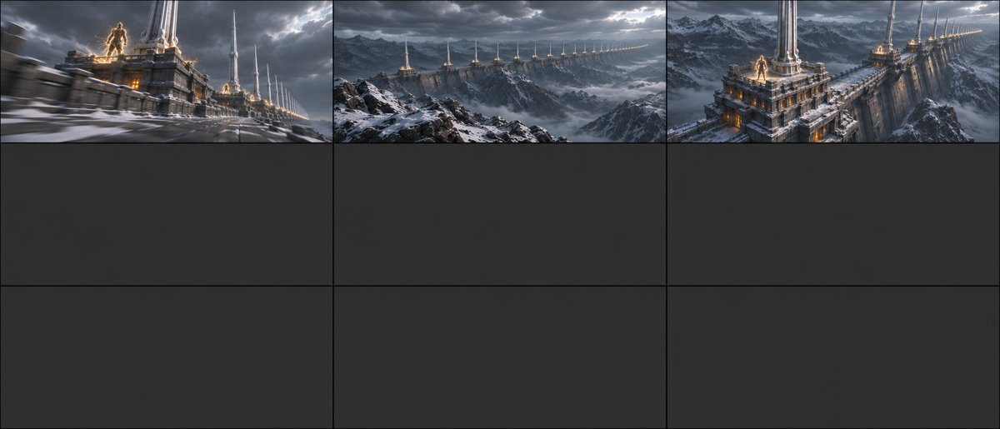

## B06-G01｜父兄重逢相认

原镜38—46；有效9格，留空0格。

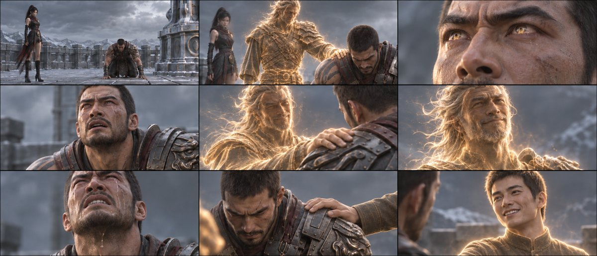

## B06-G02｜齐吼阵起与拔钉

原镜47—55；有效9格，留空0格。

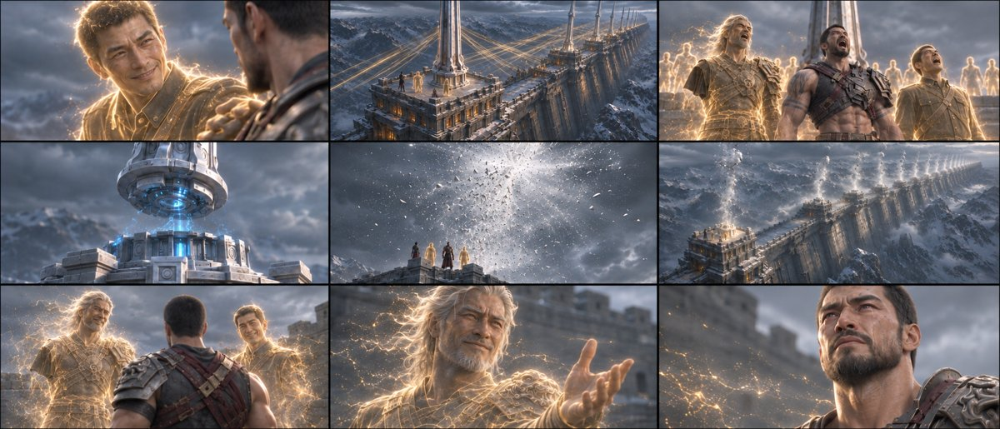

## B06-G03｜巨阙撑地告别与古砖合拢

原镜56—58；有效3格，留空6格。

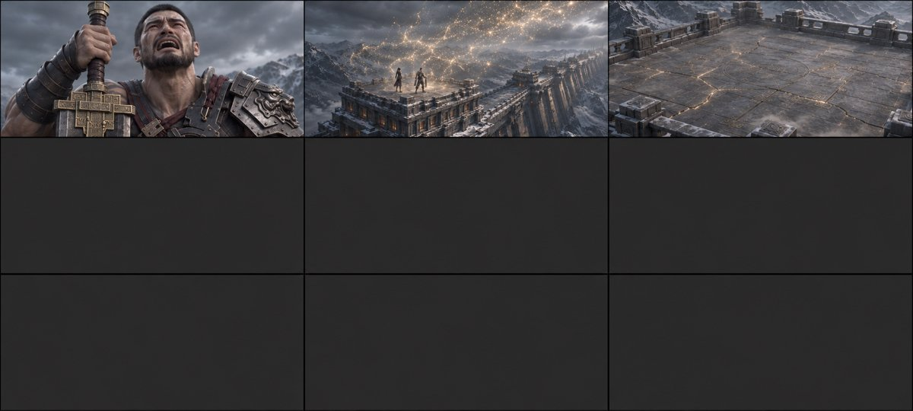

## B07-G01｜玄衡白虎入阵与龙鳞

原镜59—67；有效9格，留空0格。

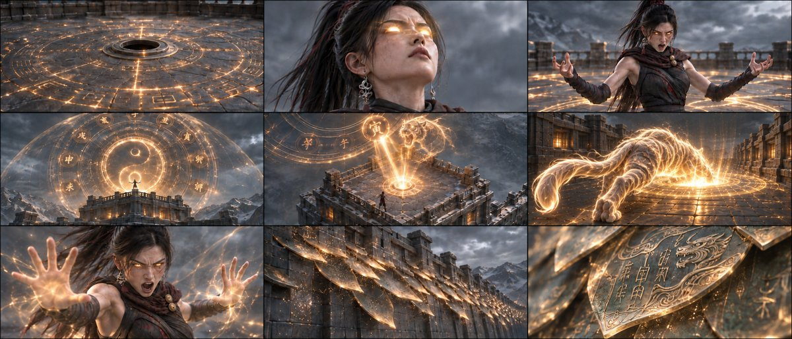

## B07-G02｜龙脊剥落显露

原镜68—70；有效3格，留空6格。

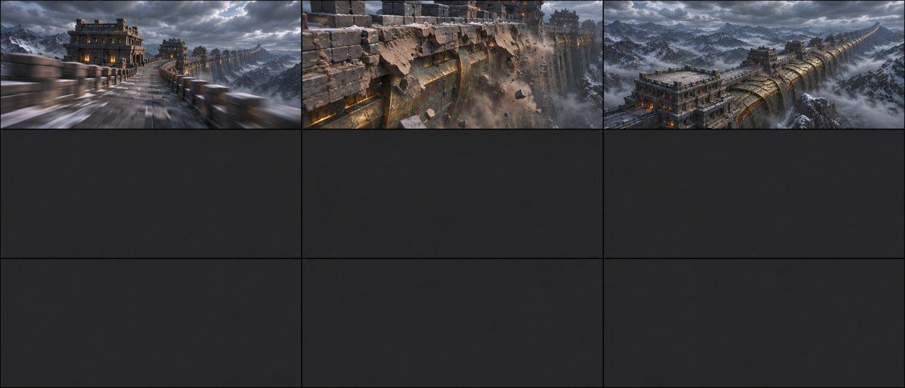

## B08-G01｜龙虎破天与雾潮化雨

原镜71—79；有效9格，留空0格。

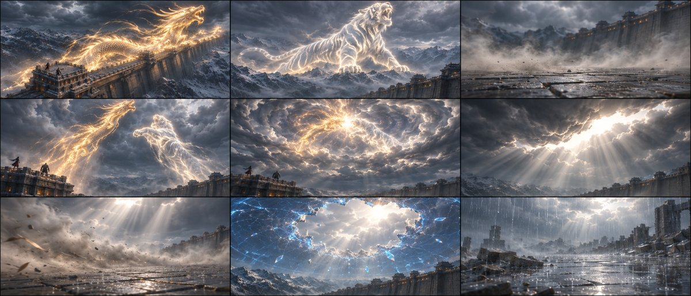

## B08-G02｜一镜复苏与阳光落土

原镜80—81；有效2格，留空7格。

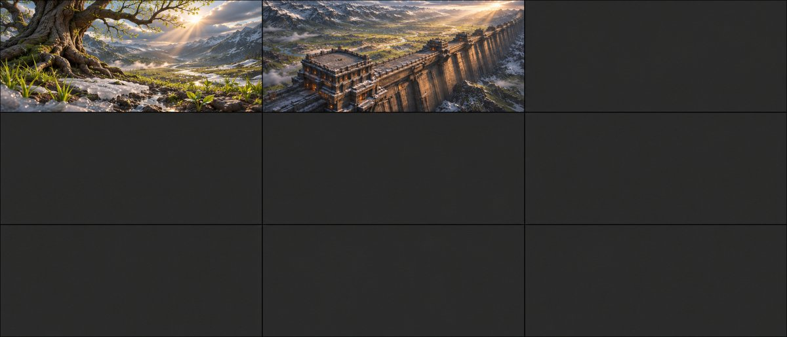

## B09-G01｜男孩接光与老兵见日

原镜82—86；有效5格，留空4格。

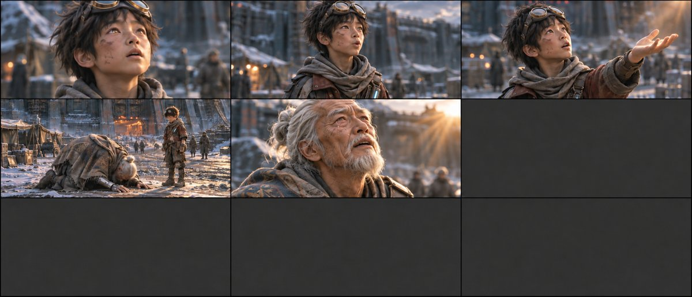

## B10-G01｜厉战震撼与凝视新绿

原镜87—93；有效7格，留空2格。

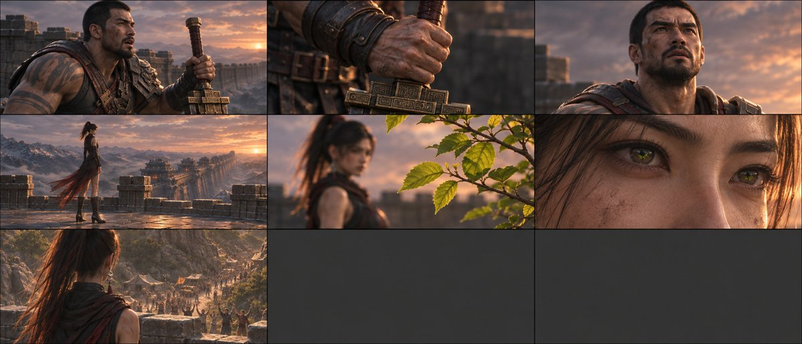

## B11-G01｜难民奔城与幽液封门

原镜94—102；有效9格，留空0格。

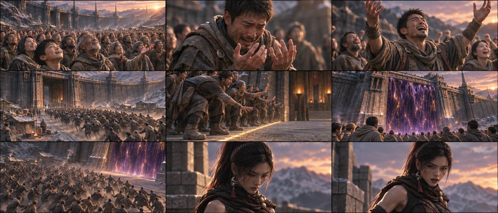
