# 第一集 V2 · 游戏宣发 · 逐动作171镜

19张九宫格，171个全剧镜号，每格一个独立主动作；所有格均有内容。当前为审核稿。

## [下载本版19张PNG与171镜脚本](https://github.com/liu-ai-cmd/LIU/raw/refs/heads/storyboard-downloads/E01_ACTION_V2_DS04.zip)

[返回三版选择页](E01_ACTION_V2_PREVIEW.md)

按原文动作展开；人物、台词与环境事件分别登记。原2:55压缩时间表和可读性优先时间表都在包内，均为剪辑方案。图像伤亡采用克制转述，生成偏差与连续性待复核项另附。

## B01-G01 · 镜号1、2、3、4、5、6、25、26、27

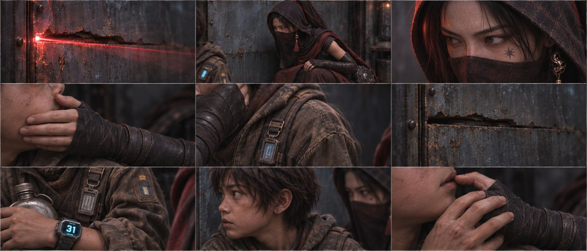

九格已目视：光缝、贴墙、眼神、捂嘴、肩颤、光退、胸牌、侧耳、移手采用不同取景。发抖与呼吸为静态代表相位；细小胸牌文字近似。

## B01-G02 · 镜号28、29、30、31、32、34、36、37、38

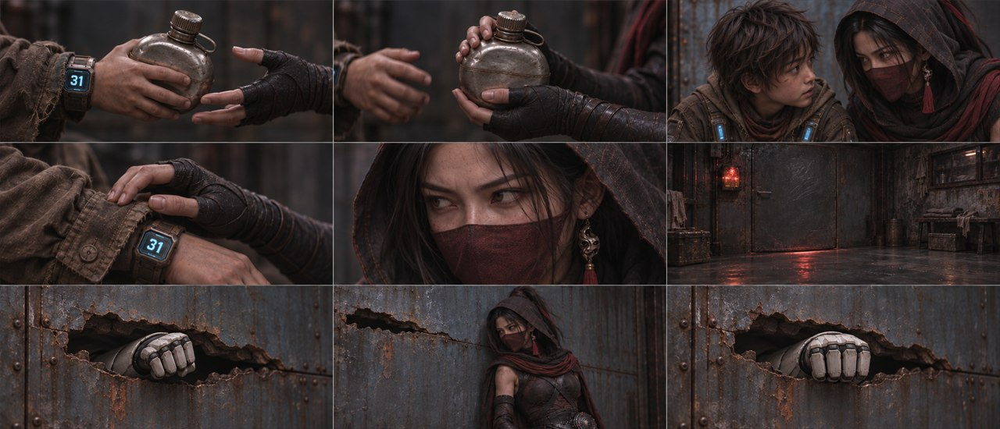

九格已目视：递壶与接壶、低语、扣腕、制止、门下反光、拳套入孔、靠墙和停拳分开。7/9为闭拳；穿孔采用已有破孔的完成相位，裂孔几何为近似。

## B01-G03 · 镜号39、40、41、42、44、47、48、49、50

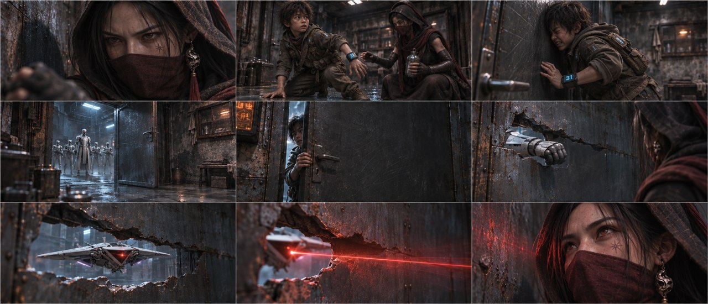

九格已目视：制止反应、挣脱、撞门、门开、关门、收拳、机降、穿洞红光、抬眼分开。孔洞尺寸及门的几何有生成近似；室内外须按全剧镜号交叉剪辑。

## B02-G01 · 镜号7、8、9、10、11、12、13、14、15

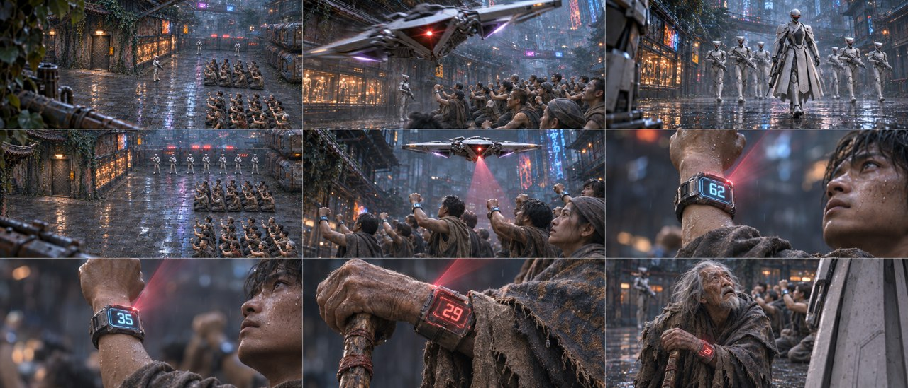

九格已目视：空间、机A、率队、封口、机B、62、35、29、老者抬头分开。腕码大数字可辨；远景人数及机B的机翼细节为近似，未作精确资产验收。

## B02-G02 · 镜号16、17、18、19、20、21、22、23、24

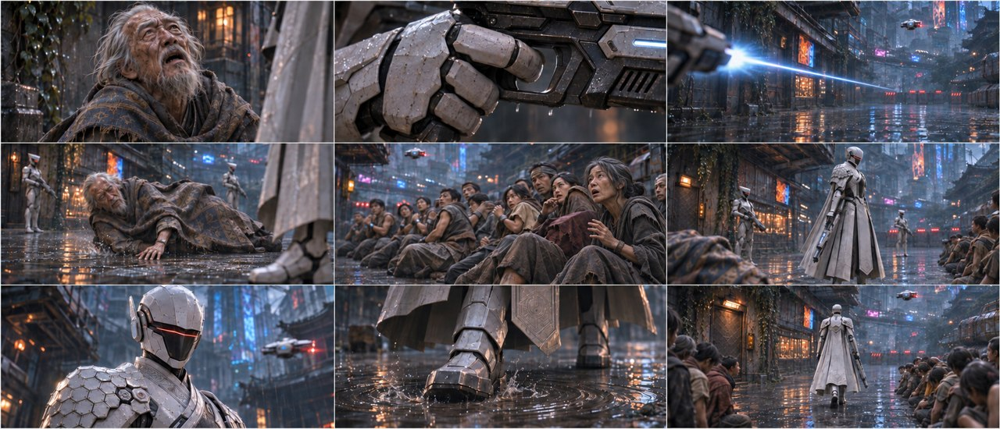

九格已目视：求饶、扣扳机、枪光、倒地、贫民反应、收枪、命令、迈靴、走近分开。射线接触及伤口留画外，老者以完整斗篷倒地表现。 第5格误入的石头已由图像工具替换成成年陌生贫民，已复看，无蓝31腕屏。

## B02-G03 · 镜号33、35、43、45、46、51、52、53、54

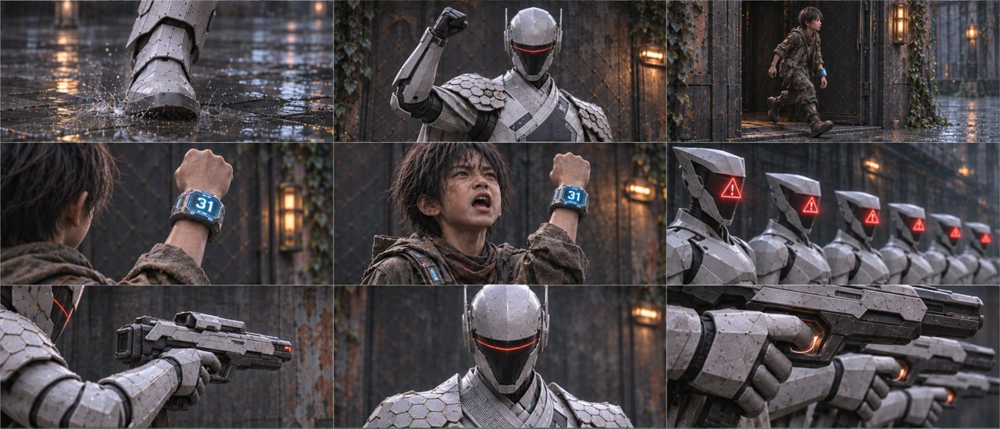

九格已目视：靴落、抬臂、石头出门、举31腕码、喊话、面罩红警、举器械、命令、机械扳机分别取景。对身体的直接攻击留画外，其他格不出现石头。

## B02-G04 · 镜号55、56、57、58、59、60、61、62、63

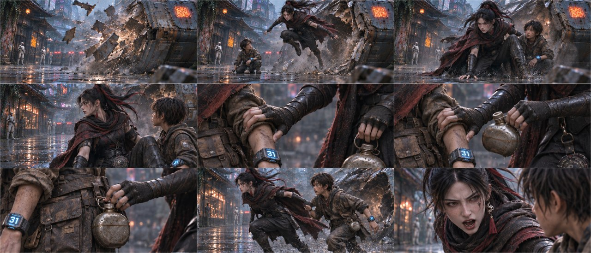

九格已目视：墙损、跃出、护人、转身、抓臂、抬壶、扣壶、起跑、喊跑分开。抬壶与扣回腰带为补充动作；手部左右及面纱时点仍需视频连续性复核。

## B03-G01 · 镜号64、65、66、67、68、69、70、71、72

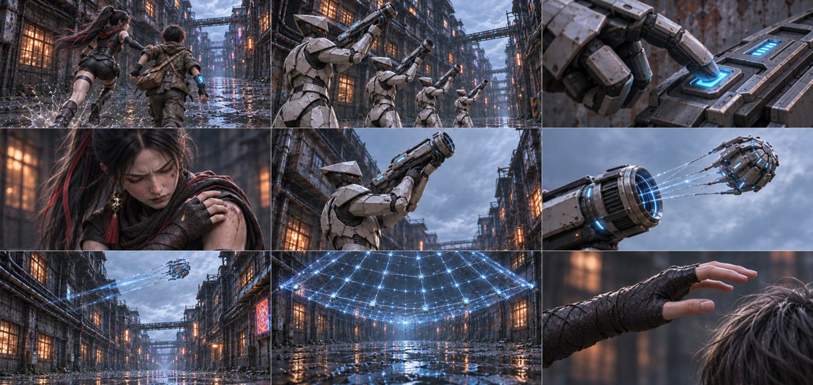

九格已目视：奔跑、白甲举设备、按键、玄初肩缩、举网具、网包离口、空中飞包、网格展开、伸手分别取景。原文齐射以机械按钮与亮灯转述，未显示枪弹接触人体。画布1821×864，与21:9有约10%比例差，本稿保留原输出未拉伸。

## B03-G02 · 镜号73、74、75、76、77、78、79、80、81

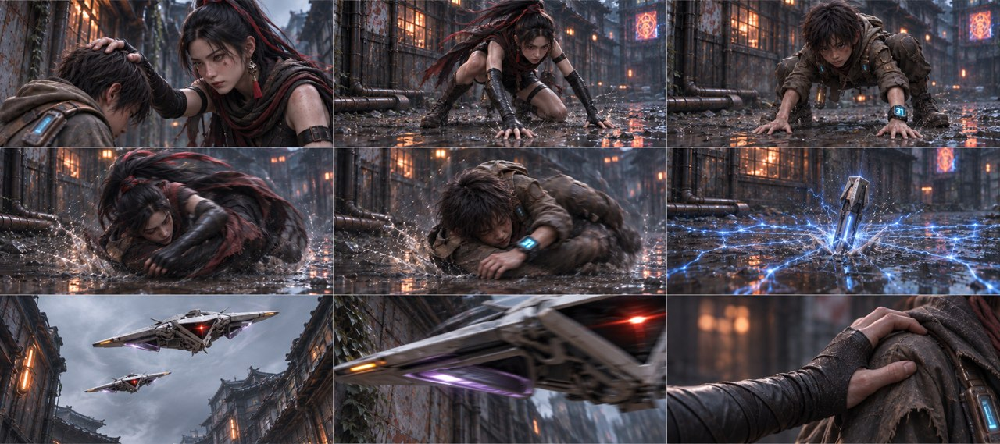

九格已目视：按头、两人分别扑倒和侧滚、电网入泥、双机、翼缘、抓肩分开。动作选一个相位；第二架无人机可进入画外，追逐面纱状态有生成时点差异。 九个阶段清楚，网与人体直接接触留画外，机翼采用擦过的完成相位。

## B03-G03 · 镜号82、83、84、85、86、87、88、89、90

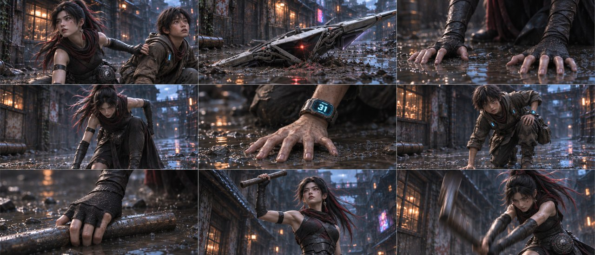

九格已目视：拉偏、卡翼、两人分别撑地与起身、抓管、举管、挥管分开。起身镜可取中间相位；追逐中帽/面纱有提前滑落及个别回显，后续视频需统一。

## B03-G04 · 镜号91、92、93、94、95、96、97、98、99

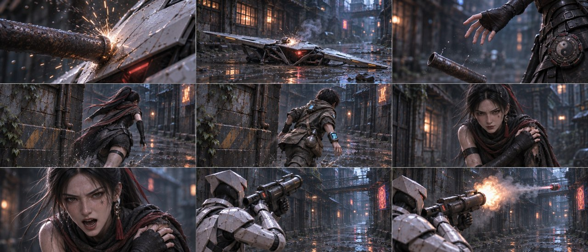

九格已目视：金属接触、坏机、松管、分别转角、护肩、口令、抬发射器、发射分开。机械接触及薄烟替代剧烈爆炸；面纱在部分近景已下滑。

## B03-G05 · 镜号100、101、102、103、104、105、106、107、108

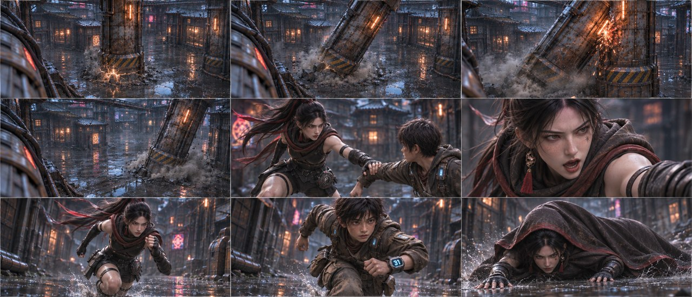

九格已目视：柱A断/倒/碰B、B倒、拉臂、口令、分别疾冲、玄初倒地分开。两柱角度、尺寸和世界坐标未做三维验证，物件镜为独立阶段示意。

## B03-G06 · 镜号109、110、111、112、113、114、115、116、117

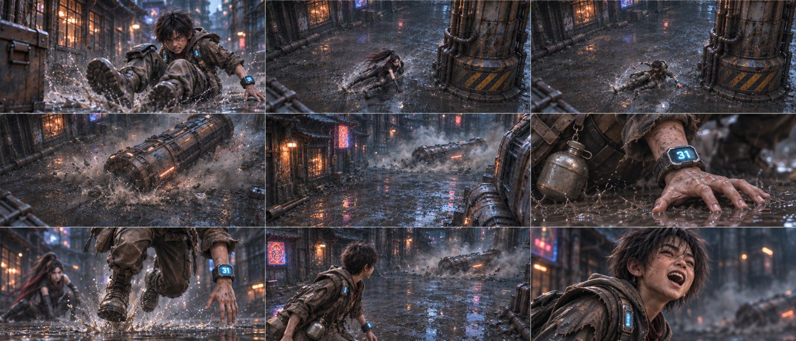

九格已目视：石头倒地、分别滑行、两柱落定、石头撑地/起身/回看/说话分开。滑行取已越过结构的末相，冲击接触采用空地镜；精确柱距仍需复核。

## B03-G07 · 镜号118、119、120、121、122、123、124、125、126

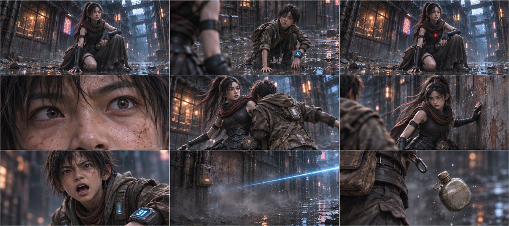

九格已目视：松气、抬眼、红点、瞳孔、推肩、侧墙平衡、喊小心、蓝光、掉壶分开。人体受击过程留画外，以反应、空墙蓝光和水壶脱落承接。

## B03-G08 · 镜号127、128、129、130、131、132、133、134、135

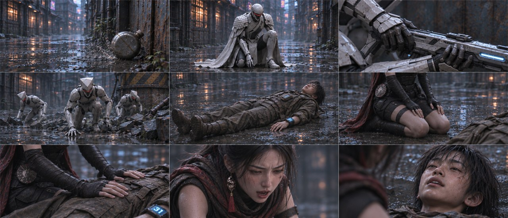

九格已目视：滚壶、队长半跪、架设备、三人爬起、石头地面平躺、玄初跪地、隔衣按扶、喊名、低语分开。仰躺与手部姿势延续下一组；未画伤口，石头没有坐起或站立。

## B03-G09 · 镜号136、137、138、139、140、141、142、143、144

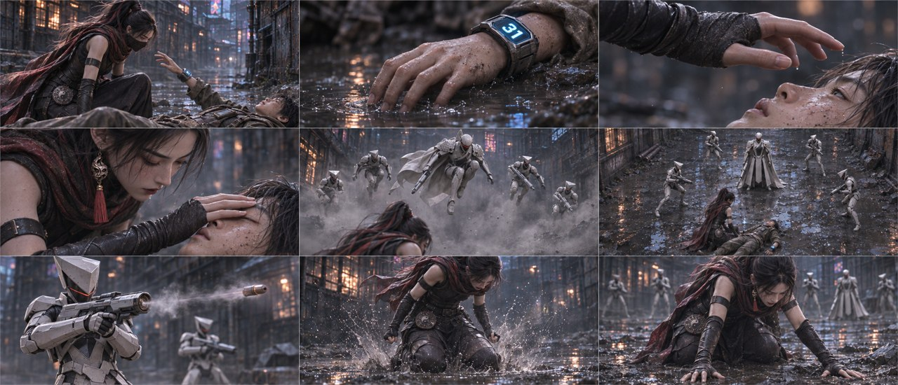

九格已目视：石头抬手、手落、玄初伸手合眼、合眼完成、白甲跃出/落位、器械单镜、双膝落地、撑地分开。前四格石头平躺；伤亡作克制转述，面纱此处回显需视频制作统一。

## B03-G10 · 镜号145、146、147、148、149、150、151、152、153

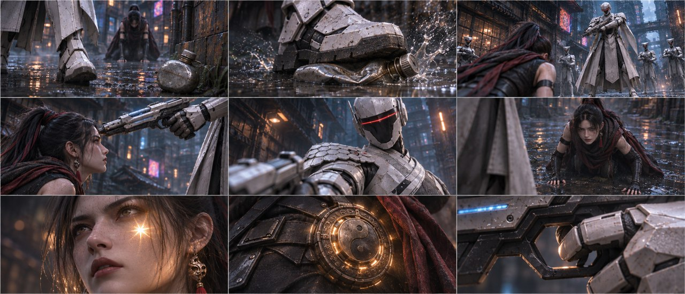

九格已目视：趋近、踩壶、抬枪、近额、命令、抬头、胎记、腰坠、扣扳机分开。少年留在画外；枪口距离、手部接触和金光强度为静态示意，未作实拍测量。

## B03-G11 · 镜号154、155、156、157、158、159、160、161、162

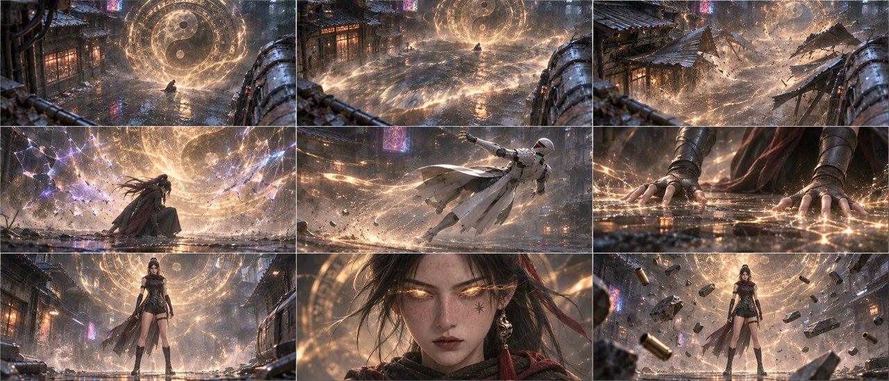

九格已目视：巨盘、气浪、铁棚、力场、队长退飞、双手撑地、玄初完全站直、金瞳、碎物悬浮分别表现。第7格双膝已直立，石头不再活动入画。静帧仅为动作关键相位。

## B03-G12 · 镜号163、164、165、166、167、168、169、170、171

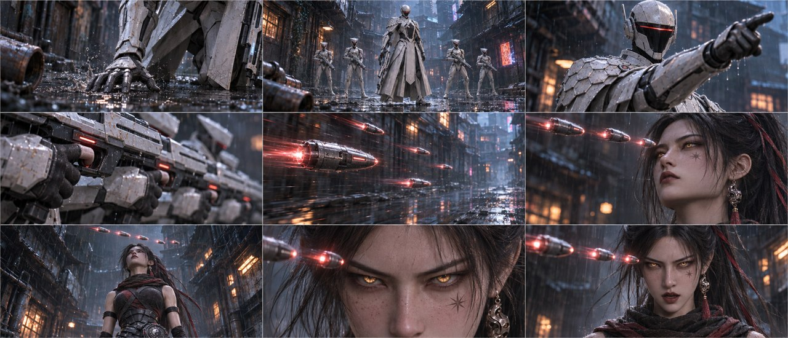

九格已目视：队长撑地、起身、下令、扳机、弹丸、悬停、抬头、锁眼、低吼分开。石头均在画外，弹丸巨大化和远景人数为生成近似；第7格取抬头完成相位。
