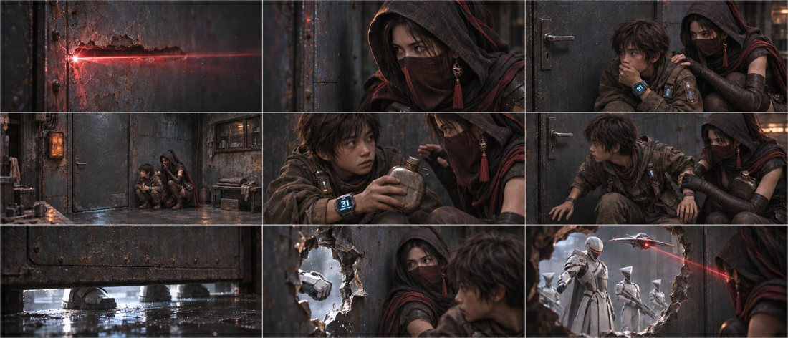
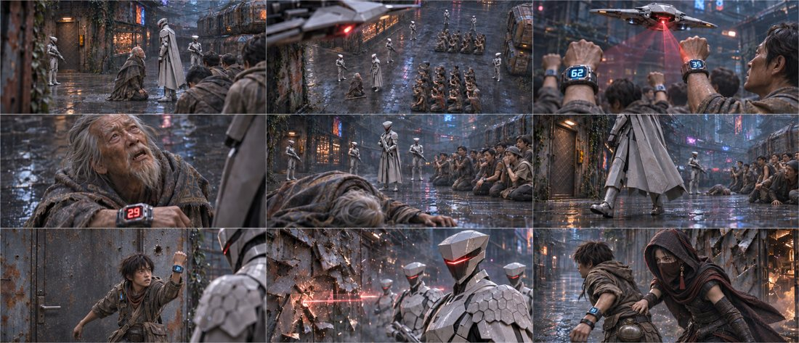
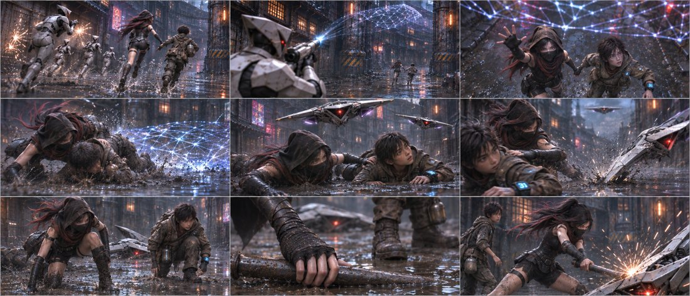
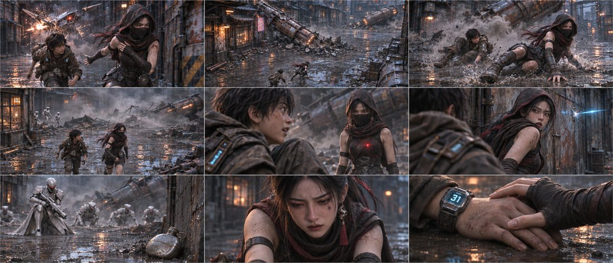
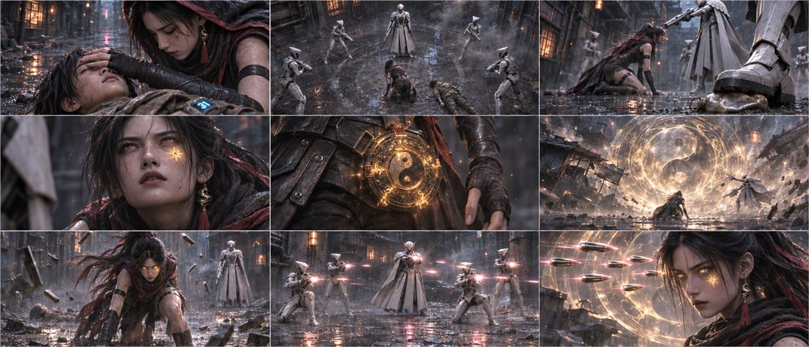

# 第一集 · 纵深连贯版

45镜 · 175秒规划 · 5张九宫格，所有格均有内容。当前为分镜审核稿。

## [下载本版PNG原图与脚本](https://github.com/liu-ai-cmd/LIU/raw/refs/heads/storyboard-downloads/E01_DS01.zip)

[返回三版选择页](E01_PREVIEW.md) ｜ [下载全部三版](https://github.com/liu-ai-cmd/LIU/raw/refs/heads/storyboard-downloads/E01_ALL_3VERSIONS.zip)

原文40镜建议已展开成45镜；受伤过程作克制转述。人数、水壶、面纱与画面差异见包内说明。静态图不代表已完成视频运镜和配音。

## B01-G01 · 全剧镜号1、2、3、4、11、12、13、14、16

[打开本组PNG原图](https://github.com/liu-ai-cmd/LIU/raw/refs/heads/storyboard-downloads/images/E01_DS01/B01-G01.png)

九格齐全。门右藏身、31腕码与水壶交接可辨。3镜改为石头自己捂嘴、玄初护肩，14镜改为已形成墙洞的反应。门下开口和拳洞的尺度由工具近似。

## B02-G01 · 全剧镜号5、6、7、8、9、10、15、17、18

[打开本组PNG原图](https://github.com/liu-ai-cmd/LIU/raw/refs/heads/storyboard-downloads/images/E01_DS01/B02-G01.png)

九格齐全，62/35/29与31可辨。已编辑第7格为关门后的石头，第9格恢复兜帽面纱与单只腰壶。远景部分执行官相互遮挡，队列人数不作精确验证。

## B03-G01 · 全剧镜号19、20、21、22、23、24、25、26、27

[打开本组PNG原图](https://github.com/liu-ai-cmd/LIU/raw/refs/heads/storyboard-downloads/images/E01_DS01/B03-G01.png)

九格齐全。电网、双机、卡翼、起身/抓管/击机三镜可辨。左肩伤以衣物与姿态呈现；红警照明及第二架无人机的后续位置为近似，远处追兵数受遮挡。

## B03-G02 · 全剧镜号28、29、30、31、32、33、34、35、36

[打开本组PNG原图](https://github.com/liu-ai-cmd/LIU/raw/refs/heads/storyboard-downloads/images/E01_DS01/B03-G02.png)

九格齐全。倒柱、滑行、红点、蓝光空墙、水壶墙根、玄初反应与双手告别可辨。35镜采用画外同伴与玄初反应。部分面纱在32镜后已下滑，早于基础方案37镜；两柱的几何与倒向没有逐帧视频验证。

## B03-G03 · 全剧镜号37、38、39、40、41、42、43、44、45

[打开本组PNG原图](https://github.com/liu-ai-cmd/LIU/raw/refs/heads/storyboard-downloads/images/E01_DS01/B03-G03.png)

九格齐全。合眼、包围、踩壶、胎记、玄衡、浮铁与悬弹可辨。43镜呈起身中间姿态而非完全站直；高速运动和悬弹距离为设计意图，非可测的实拍参数。
