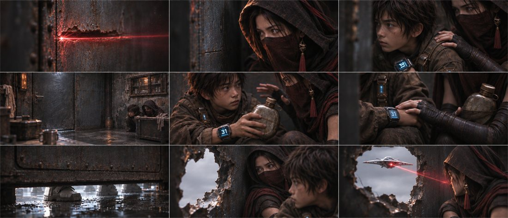
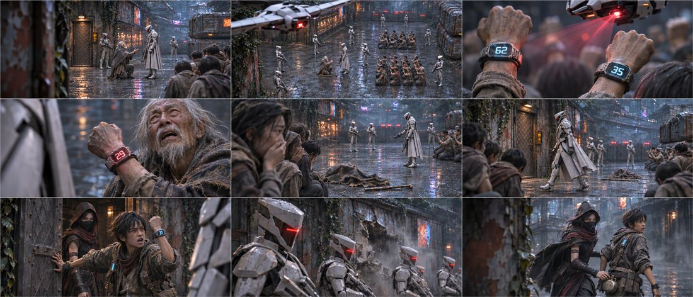
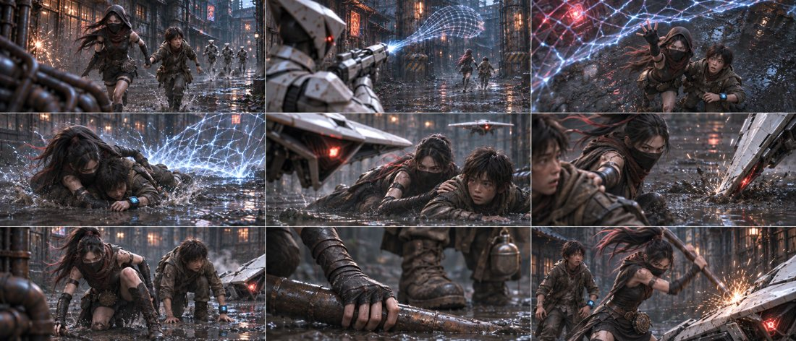
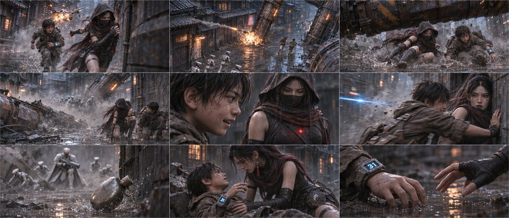
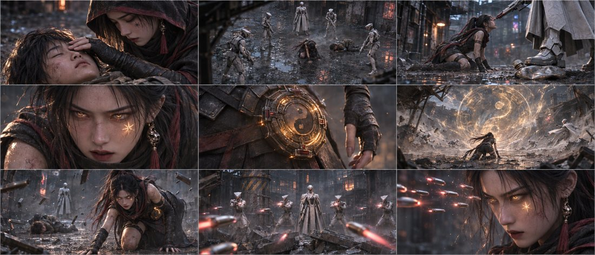

# 第一集 · 情绪碎片版

45镜 · 175秒规划 · 5张九宫格，所有格均有内容。当前为分镜审核稿。

## [下载本版PNG原图与脚本](https://github.com/liu-ai-cmd/LIU/raw/refs/heads/storyboard-downloads/E01_DS03.zip)

[返回三版选择页](E01_PREVIEW.md) ｜ [下载全部三版](https://github.com/liu-ai-cmd/LIU/raw/refs/heads/storyboard-downloads/E01_ALL_3VERSIONS.zip)

原文40镜建议已展开成45镜；受伤过程作克制转述。人数、水壶、面纱与画面差异见包内说明。静态图不代表已完成视频运镜和配音。

## B01-G01 · 全剧镜号1、2、3、4、11、12、13、14、16

[打开本组PNG原图](https://github.com/liu-ai-cmd/LIU/raw/refs/heads/storyboard-downloads/images/E01_DS03/B01-G01.png)

九格齐全。以已生成室内图为编辑参考重构；3镜主打肩手、12镜改成温和腕侧接触，14镜空洞仅见白光，人物衣物遮盖完整。部分腕屏受透视影响字符近似；门下缝与拳洞比例为生成近似。

## B02-G01 · 全剧镜号5、6、7、8、9、10、15、17、18

[打开本组PNG原图](https://github.com/liu-ai-cmd/LIU/raw/refs/heads/storyboard-downloads/images/E01_DS03/B02-G01.png)

九格齐全。62/35/29与出门31可辨；老者离场由斗篷、手杖与贫民反应表达。17镜警报及受损外壁、18镜烟尘中离开。第7格仍选在开门至关门过程，玄初位于门内，关门完成由工程动作说明。

## B03-G01 · 全剧镜号19、20、21、22、23、24、25、26、27

[打开本组PNG原图](https://github.com/liu-ai-cmd/LIU/raw/refs/heads/storyboard-downloads/images/E01_DS03/B03-G01.png)

九格齐全。遮挡与局部镜增加，网/机/铁管步骤可辨。衣布短拖影仅为静态提示，抽帧率须在后续视频实施。第二架无人机并非每格可见，进入画外延续。

## B03-G02 · 全剧镜号28、29、30、31、32、33、34、35、36

[打开本组PNG原图](https://github.com/liu-ai-cmd/LIU/raw/refs/heads/storyboard-downloads/images/E01_DS03/B03-G02.png)

九格齐全。第8格实际仍画出完整衣物的石头与玄初同框，尽管生成提示词选了玄初单人反应；画面保留此非图形化的临终表演。面纱于蓝光反应后下滑。原文伤亡由表演与手落镜承接，开放伤口未画。

## B03-G03 · 全剧镜号37、38、39、40、41、42、43、44、45

[打开本组PNG原图](https://github.com/liu-ai-cmd/LIU/raw/refs/heads/storyboard-downloads/images/E01_DS03/B03-G03.png)

九格齐全。合眼、金痕、腰坠、巨玄衡、悬弹可辨。43镜是撑地起身中间相位。前景碎铁和敌阵反打保持情绪碎片取向，物理眼线和远景人数仍需视频阶段复核。
