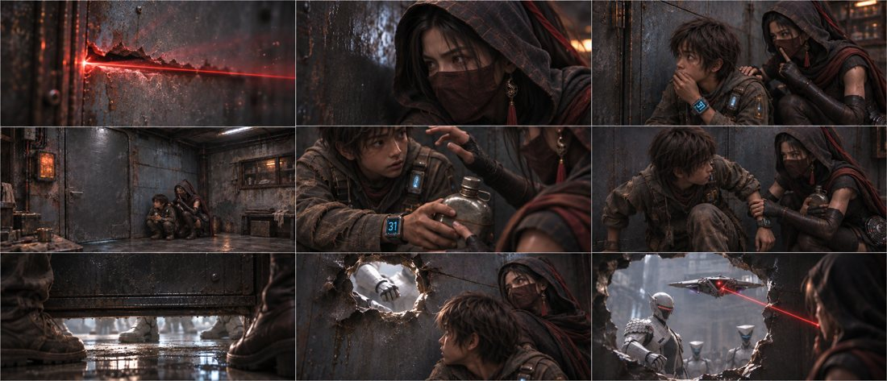
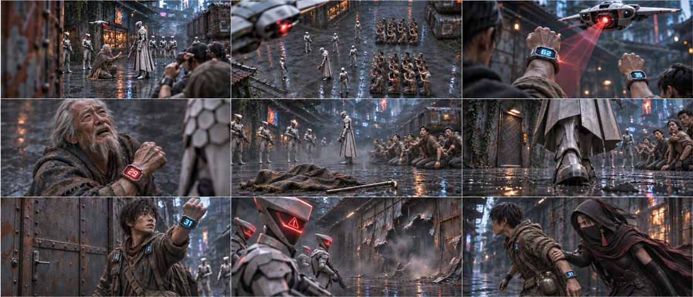
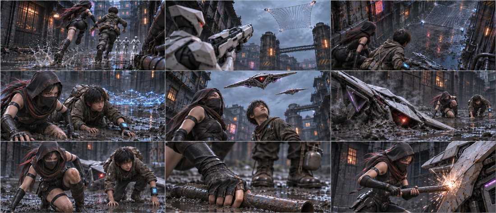
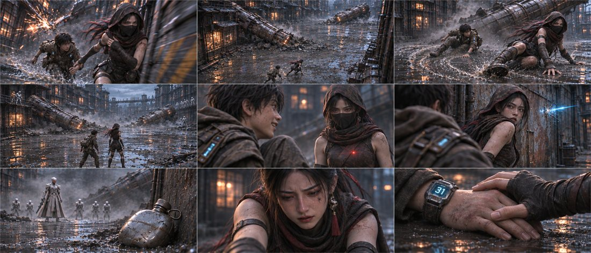
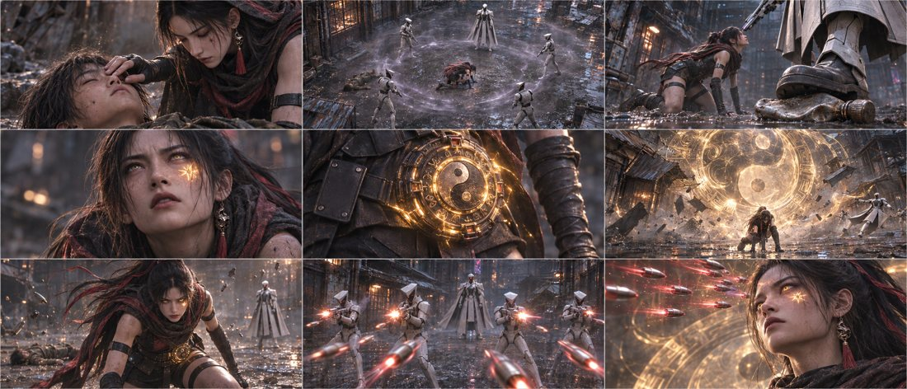

# 第一集 · 游戏宣发版

45镜 · 175秒规划 · 5张九宫格，所有格均有内容。当前为分镜审核稿。

## [下载本版PNG原图与脚本](https://github.com/liu-ai-cmd/LIU/raw/refs/heads/storyboard-downloads/E01_DS04.zip)

[返回三版选择页](E01_PREVIEW.md) ｜ [下载全部三版](https://github.com/liu-ai-cmd/LIU/raw/refs/heads/storyboard-downloads/E01_ALL_3VERSIONS.zip)

原文40镜建议已展开成45镜；受伤过程作克制转述。人数、水壶、面纱与画面差异见包内说明。静态图不代表已完成视频运镜和配音。

## B01-G01 · 全剧镜号1、2、3、4、11、12、13、14、16

[打开本组PNG原图](https://github.com/liu-ai-cmd/LIU/raw/refs/heads/storyboard-downloads/images/E01_DS04/B01-G01.png)

九格齐全。门右双人与31水壶可辨；威胁转为环境与反应。与其他版本保留同一叙事节点，主要差异为机位高度、近物尺度与短推短拉方案。

## B02-G01 · 全剧镜号5、6、7、8、9、10、15、17、18

[打开本组PNG原图](https://github.com/liu-ai-cmd/LIU/raw/refs/heads/storyboard-downloads/images/E01_DS04/B02-G01.png)

九格齐全。修正后第7格铁门关闭、腕屏31；第9格恢复兜帽面纱及单只腰壶。第5格由落下斗篷与手杖交代老者离场，第8格改警报与已损墙体，舍去直接射击过程。

## B03-G01 · 全剧镜号19、20、21、22、23、24、25、26、27

[打开本组PNG原图](https://github.com/liu-ai-cmd/LIU/raw/refs/heads/storyboard-downloads/images/E01_DS04/B03-G01.png)

九格齐全。电网和双机改为更大空间间隔，画避让后状态。已编辑第6格：两人留在无人机旁撑地，承接第5/7格；第9格成年玄初单独击打机械。人物/机械间距和摄影视角属于关键帧示意。

## B03-G02 · 全剧镜号28、29、30、31、32、33、34、35、36

[打开本组PNG原图](https://github.com/liu-ai-cmd/LIU/raw/refs/heads/storyboard-downloads/images/E01_DS04/B03-G02.png)

九格齐全。基于已生成DS01同组进行广角重构，柱倒结果、滑行末相、红点、水壶与玄初反应明确。第6格面纱已滑至下巴，第8格只画成年玄初；敌阵远景出现多余或遮挡轮廓，不能视为严格五人的人数验收。

## B03-G03 · 全剧镜号37、38、39、40、41、42、43、44、45

[打开本组PNG原图](https://github.com/liu-ai-cmd/LIU/raw/refs/heads/storyboard-downloads/images/E01_DS04/B03-G03.png)

九格齐全。巨玄衡与屋檐/人同框给尺度，悬弹为收束。43镜是低姿态站起过程，英雄段尚不是完全站直的海报帧。卡点、升降和光效均为后续视频方案，静态图未进行声画同步测试。
