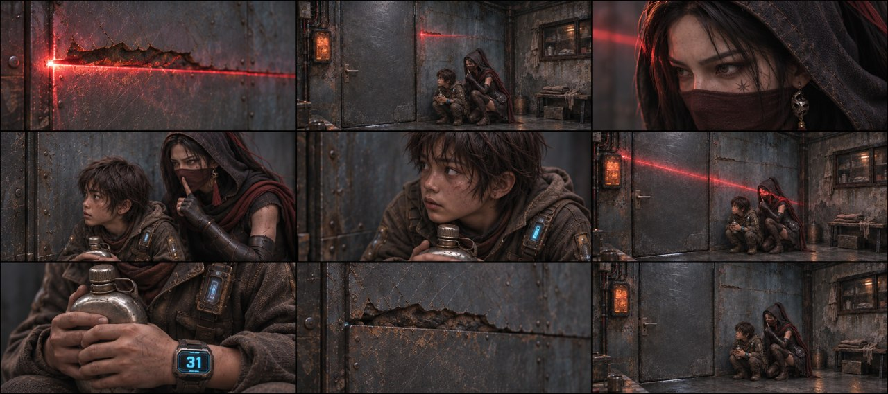

# B01-G01 · 裂缝扫描与屋内藏身

制作中：本组已完成2/5张，当前仅列真实可下载的图。

[返回全部组](../E01_ORIGINAL_V3_PREVIEW.md)

## 候选01 · 正侧交代

[直接下载PNG](https://github.com/liu-ai-cmd/LIU/raw/refs/heads/storyboard-downloads/images/E01_ORIGINAL_V3/E01-B01-G01-I01.png)

九格已目视，藏身、眼神、抱壶、光退与阴暗结束完整。原文捂嘴已明确转述为成人对自己作安静手势，二人不接触；实际图中下身主要由外披遮挡。1881×836，约3.6%画幅偏差；不可辨胸牌细字不作验收。

## 候选02 · 略低机位

[直接下载PNG](https://github.com/liu-ai-cmd/LIU/raw/refs/heads/storyboard-downloads/images/E01_ORIGINAL_V3/E01-B01-G01-I02.png)

九格已逐格目视，剧情顺序与本组首张相同，机位和局部距离有变化，无黑格；人物与物件未见明显新增错误。静态颤动、远景人数和细小铭牌仍不可精确验收；1881×836为近似21:9。

## 该组完整原文

玄初（VO）：在这个世界，司命殿用算法统治着人类的生死，而我，是他们找了十年的系统漏洞。
破铁皮屋内，一道一寸宽的锈蚀裂缝横在画面中央。猩红色激光束透过铁缝隙照亮铁皮房内。
玄初贴墙半蹲在缝隙后，特写冷暖两色的光在她脸上各占一半。这段画外音压在这组画面上。
镜头下移，玄初（戴帽和面纱）【字幕：系统漏洞 玄初】右手死死捂住石头【字幕：底层拾荒者 石头】发抖的嘴！扫描激光束斜切照亮他们的上半身。
光束（随无人机的离开）消失，铁皮房内又恢复阴暗。
