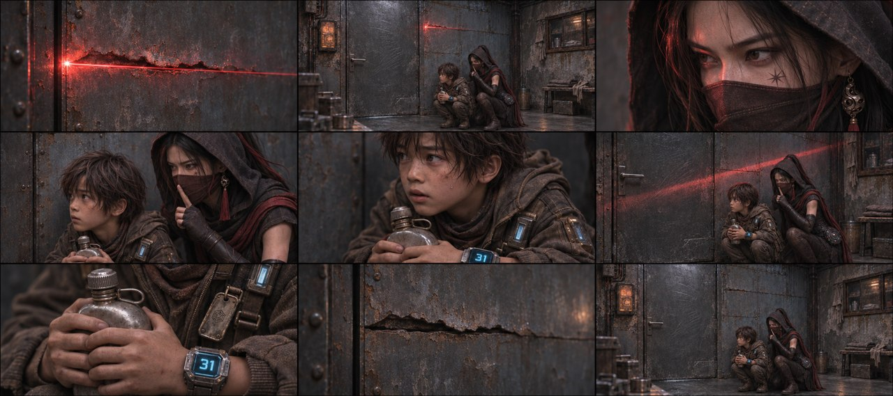
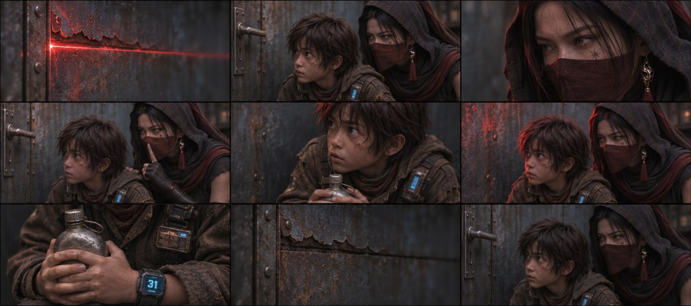
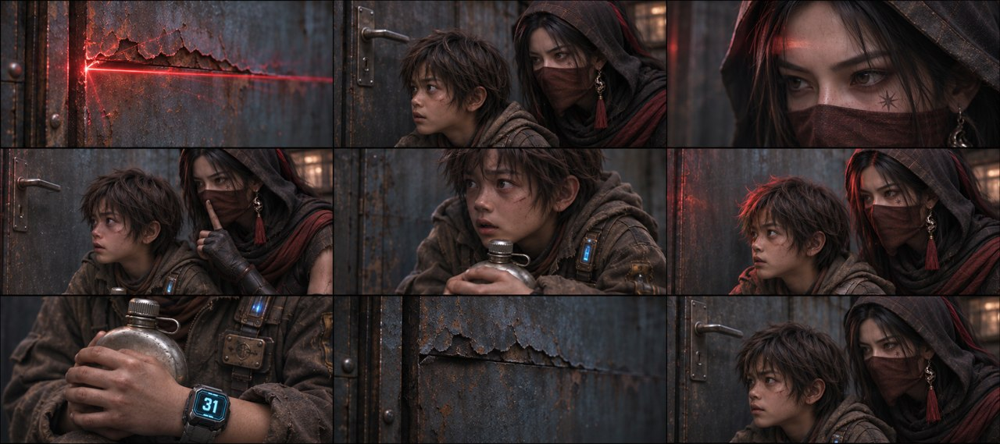
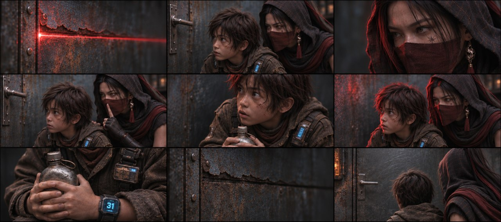

# B01-G01 · 裂缝扫描与屋内藏身

5张完整九宫格，同组九格阅读顺序一致，均为审核稿。

[返回全部11组](../E01_ORIGINAL_V3_PREVIEW.md) · [下载所在独立包](https://github.com/liu-ai-cmd/LIU/raw/refs/heads/storyboard-downloads/E01_ORIGINAL_V3_B01.zip)

|图号|机位候选|PNG原图|

|---|---|---|

|图01|正侧交代|[直接下载PNG](https://github.com/liu-ai-cmd/LIU/raw/refs/heads/storyboard-downloads/images/E01_ORIGINAL_V3/E01-B01-G01-I01.png)|

|图02|略低机位|[直接下载PNG](https://github.com/liu-ai-cmd/LIU/raw/refs/heads/storyboard-downloads/images/E01_ORIGINAL_V3/E01-B01-G01-I02.png)|

|图03|斜俯观察|[直接下载PNG](https://github.com/liu-ai-cmd/LIU/raw/refs/heads/storyboard-downloads/images/E01_ORIGINAL_V3/E01-B01-G01-I03.png)|

|图04|过肩反应|[直接下载PNG](https://github.com/liu-ai-cmd/LIU/raw/refs/heads/storyboard-downloads/images/E01_ORIGINAL_V3/E01-B01-G01-I04.png)|

|图05|远近对照|[直接下载PNG](https://github.com/liu-ai-cmd/LIU/raw/refs/heads/storyboard-downloads/images/E01_ORIGINAL_V3/E01-B01-G01-I05.png)|

## 图01 · 正侧交代

九格已目视，藏身、眼神、抱壶、光退与阴暗结束完整。原文捂嘴已明确转述为成人对自己作安静手势，二人不接触；实际图中下身主要由外披遮挡。1881×836，约3.6%画幅偏差；不可辨胸牌细字不作验收。

## 图02 · 略低机位

九格已逐格目视，剧情顺序与本组首张相同，机位和局部距离有变化，无黑格；人物与物件未见明显新增错误。静态颤动、远景人数和细小铭牌仍不可精确验收；1881×836为近似21:9。

## 图03 · 斜俯观察

九格已目视，光缝、双人肩脸关系、玄初示静、石头抱壶、红光经过/退出与暗处结束可辨。为实际生成约束，捂嘴转述为成人自己的安静手势；下身在画外，不能据此证明隐藏肢体。 实际1881×836，为近似21:9；PNG未经拉伸或裁切。

## 图04 · 过肩反应

九格已目视，光缝、双人肩脸关系、玄初示静、石头抱壶、红光经过/退出与暗处结束可辨。为实际生成约束，捂嘴转述为成人自己的安静手势；下身在画外，不能据此证明隐藏肢体。 实际1881×836，为近似21:9；PNG未经拉伸或裁切。

## 图05 · 远近对照

已目视九格：红光裂缝、两人藏身、玄初眼神、自己示静、石头紧张、水壶与31、扫描消失、肩背关系完整。无空黑格。示静动作替代捂嘴，原文另存。

## 九格剧情顺序

### 全剧001 · 红光入缝

一寸宽锈蚀裂缝占画面，红色扫描光穿过铁皮，划出一条细亮线。只呈现裂缝和光，没有屋外事件。

### 全剧002 · 玄初贴墙

玄初背贴原图门右铁壁半蹲，石头位于她前方偏左。用双人中景交代铁门、裂缝和二人之间的真实距离。

### 全剧003 · 玄初观察

取玄初眼睛与额头近景，兜帽和面纱保持，冷天光与红扫描反光分开落在脸上，视线对着门缝。

### 全剧004 · 玄初捂嘴

玄初自己的右手轻覆石头嘴前，自己的左手停在石头肩边。双人上半身能辨接触手与二人身份，不画额外手臂。

### 全剧005 · 石头颤抖

石头肩膀收紧，眼神惊惧，玄初的右手仍在原接触位置；衣物、脸部完整，靠姿态传达发抖。

### 全剧006 · 扫描越身

一道斜红光沿铁壁越过两人的上半身，二人不换位，仍蹲伏；光线移动是本格主事件。

### 全剧007 · 水壶与胸牌

石头双手稳抱旧铁皮水壶，胸口金属铭牌和蓝31腕屏同时留在局部画面，器物各一件。

### 全剧008 · 扫描退出

取原锈裂缝边缘，红亮线退到缝外，室内阴影重新包住前景。窗内暖反光微弱保留。

### 全剧009 · 阴暗中屏息

二人仍在门右原墙角压低身体，玄初的手和石头肩线延续前格，水壶留在石头怀里，铁门仍闭。

展开该组完整原文

玄初（VO）：在这个世界，司命殿用算法统治着人类的生死，而我，是他们找了十年的系统漏洞。
破铁皮屋内，一道一寸宽的锈蚀裂缝横在画面中央。猩红色激光束透过铁缝隙照亮铁皮房内。
玄初贴墙半蹲在缝隙后，特写冷暖两色的光在她脸上各占一半。这段画外音压在这组画面上。
镜头下移，玄初（戴帽和面纱）【字幕：系统漏洞 玄初】右手死死捂住石头【字幕：底层拾荒者 石头】发抖的嘴！扫描激光束斜切照亮他们的上半身。
光束（随无人机的离开）消失，铁皮房内又恢复阴暗。

