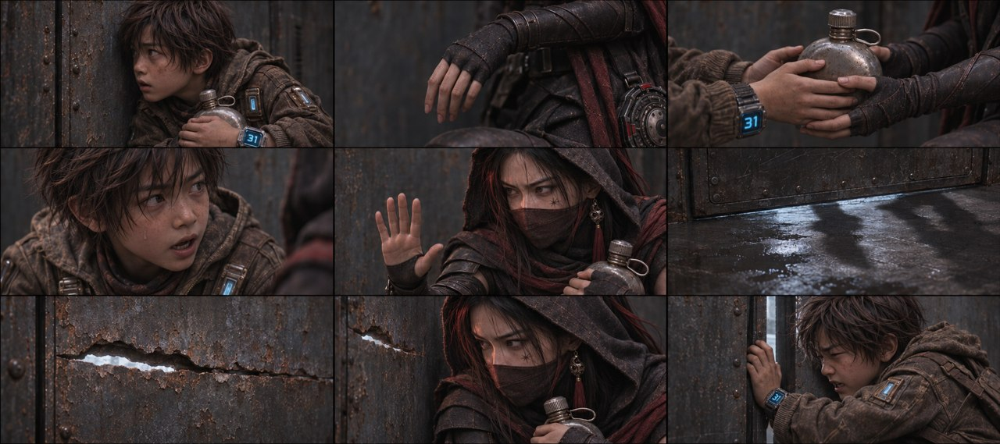
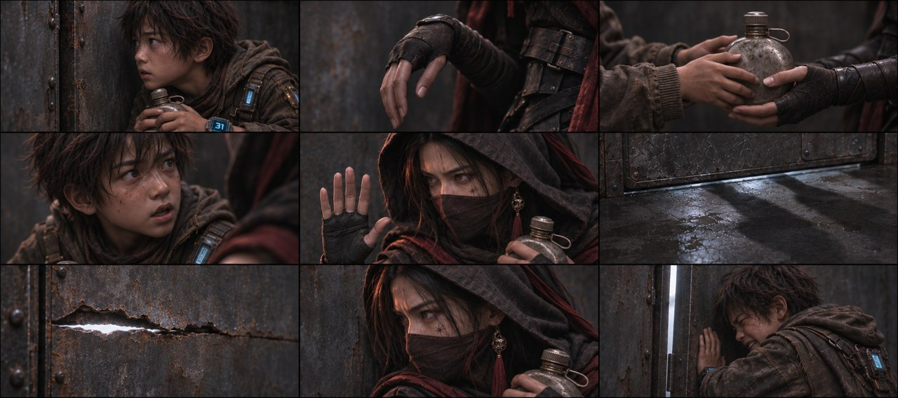
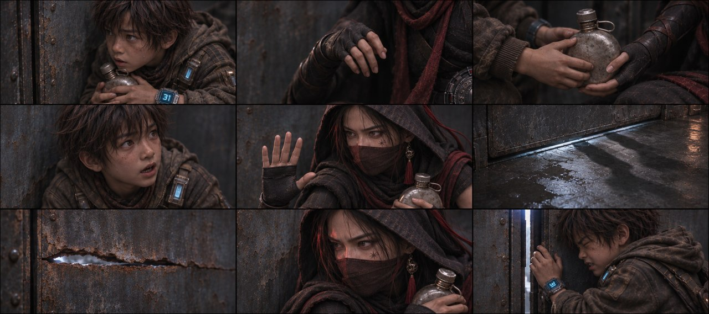
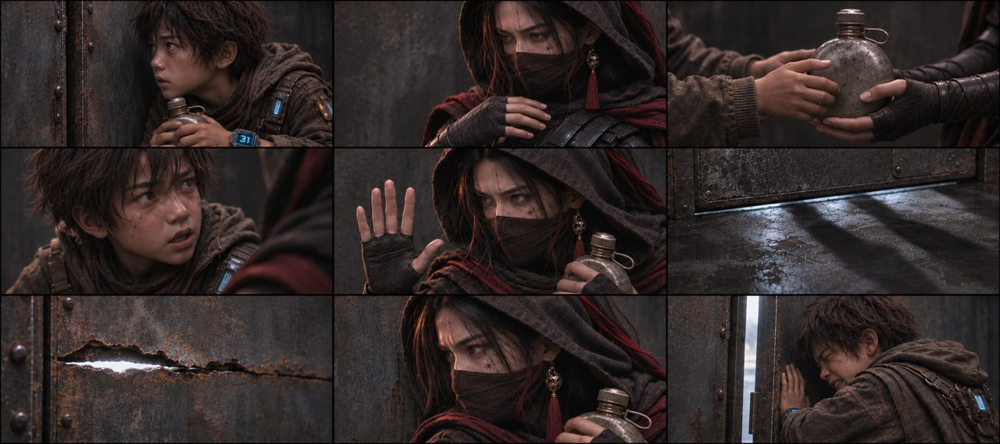
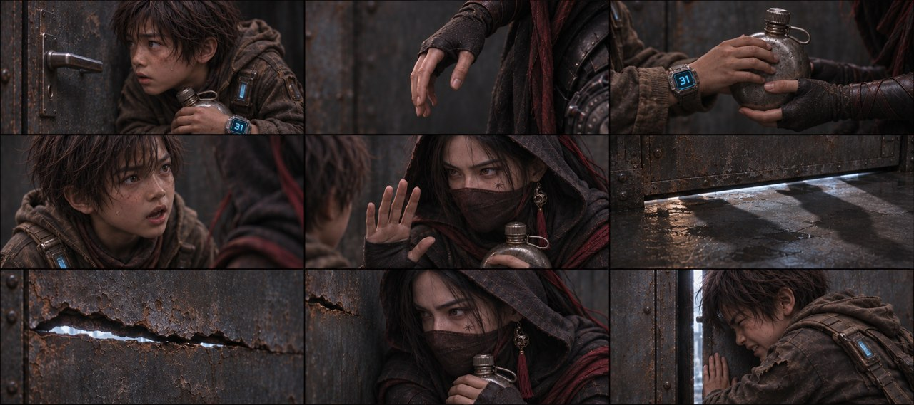

# B01-G02 · 递水壶与破门危机

5张完整九宫格，同组九格阅读顺序一致，均为审核稿。

[返回全部11组](../E01_ORIGINAL_V3_PREVIEW.md) · [下载所在独立包](https://github.com/liu-ai-cmd/LIU/raw/refs/heads/storyboard-downloads/E01_ORIGINAL_V3_B01.zip)

|图号|机位候选|PNG原图|

|---|---|---|

|图01|正侧交代|[直接下载PNG](https://github.com/liu-ai-cmd/LIU/raw/refs/heads/storyboard-downloads/images/E01_ORIGINAL_V3/E01-B01-G02-I01.png)|

|图02|略低机位|[直接下载PNG](https://github.com/liu-ai-cmd/LIU/raw/refs/heads/storyboard-downloads/images/E01_ORIGINAL_V3/E01-B01-G02-I02.png)|

|图03|斜俯观察|[直接下载PNG](https://github.com/liu-ai-cmd/LIU/raw/refs/heads/storyboard-downloads/images/E01_ORIGINAL_V3/E01-B01-G02-I03.png)|

|图04|过肩反应|[直接下载PNG](https://github.com/liu-ai-cmd/LIU/raw/refs/heads/storyboard-downloads/images/E01_ORIGINAL_V3/E01-B01-G02-I04.png)|

|图05|远近对照|[直接下载PNG](https://github.com/liu-ai-cmd/LIU/raw/refs/heads/storyboard-downloads/images/E01_ORIGINAL_V3/E01-B01-G02-I05.png)|

## 图01 · 正侧交代

九格已目视：听门、成人收自己的手、递接同一水壶、石头说话、玄初掌心示停、门下影子、空孔、女主反应、少年推门。原文移手、扣腕和近身挥拳作克制转述，不冒称已经画出拳套或捂嘴；手的持壶顺序可读。 本图1881×836，为近似21:9（约3.6%偏差），未拉伸或裁切PNG。

## 图02 · 略低机位

九格已目视，听门、成人收回自己的手、递接同一壶、说话、掌心示停、门下影子、空孔、女主反应和少年推门相接。原文扣腕/近身挥拳通过反应与结果转述，不能声称画出了实施过程。 实际1881×836，为近似21:9；PNG未经拉伸或裁切。

## 图03 · 斜俯观察

九格已目视，听门、成人收回自己的手、递接同一壶、说话、掌心示停、门下影子、空孔、女主反应和少年推门相接。原文扣腕/近身挥拳通过反应与结果转述，不能声称画出了实施过程。 实际1881×836，为近似21:9；PNG未经拉伸或裁切。

## 图04 · 过肩反应

已目视九格：石头听门、玄初自己的手收回、交接水壶、低声对白、掌心制止、门底影子、锈缝、玄初反应、石头推门。水壶在玄初手中承接后续；原拳头威胁改空锈缝。

## 图05 · 远近对照

九格已目视，听门、成人收回自己的手、递接同一壶、说话、掌心示停、门下影子、空孔、女主反应和少年推门相接。原文扣腕/近身挥拳通过反应与结果转述，不能声称画出了实施过程。 实际1881×836，为近似21:9；PNG未经拉伸或裁切。

## 九格剧情顺序

### 全剧028 · 听见脚步

石头靠着原墙角缩紧肩膀，侧耳朝门外脚步方向；胸牌、蓝31腕屏仍佩戴，水壶还在怀中。

### 全剧029 · 移开捂嘴手

石头轻抬手，将玄初自己的右手从嘴前移开，玄初手仍自然连着自身手腕；二人膝脚位置不变。

### 全剧030 · 递出水壶

石头用双手把唯一水壶递向玄初怀中，玄初自己的左手接稳。交接相位里两人都接触水壶，没有第二只壶。

### 全剧031 · 低声劝离

石头仰脸轻声对玄初说话，玄初左手已握稳水壶，石头放开水壶，蓝31仍在其腕上。

### 全剧032 · 扣腕制止

玄初自己的右手扣住石头前臂衣袖位置，左手保留水壶；两人眼神相接，姿态克制，没有伤口。

### 全剧033 · 门下红反光

从室内拍铁门下方破缝，门外一道暗红反光滑过湿地；只见反光和金属边，所有人体在画外。

### 全剧034 · 拳套穿孔

只拍锈壁不规则裂孔中的白甲闭拳，手臂连到孔外。玄初与石头均在本格画外，不显示近身打击接触。

### 全剧035 · 玄初抵壁

玄初背紧贴门右铁壁，面纱和兜帽保持，左手抱紧水壶，右手仍停石头袖腕处；惊惧靠眼神与屏息表达。

### 全剧036 · 石头撞门

石头挣开玄初的右手后，以肩抵住原关闭铁门，将门推开一条通路；玄初留在原墙角，不跟着出门。

展开该组完整原文

△ 狭小的铁皮屋内，近景拍石头吓得浑身发抖，胸前挂着【石头】铭牌，手腕条形码亮着蓝色数字【命运值：31】。他听着越来越近的脚步声，轻轻掰开玄初捂嘴的手，将铁皮水壶塞进玄初怀里。
石头（极低的气音，发抖）：初初，我有31点能过关，你测不出命运值，被抓到就死定了！
玄初（反手死死扣住石头手腕，低声）：别动！
△ 咔嚓！执行官队长一脚踩在门外的尸体上，滚烫的鲜血顺着下方破缝飙射进来，淌在玄初和石头脚边。
突然执行官队长抬起手臂，
一拳直接捅进屋内，拳头距离玄初的眉心仅有半寸。玄初后背抵死铁壁，退无可退，连呼吸都停住了！！
△ 石头猛地挣脱玄初的手，用肩膀狠狠撞开铁门，

