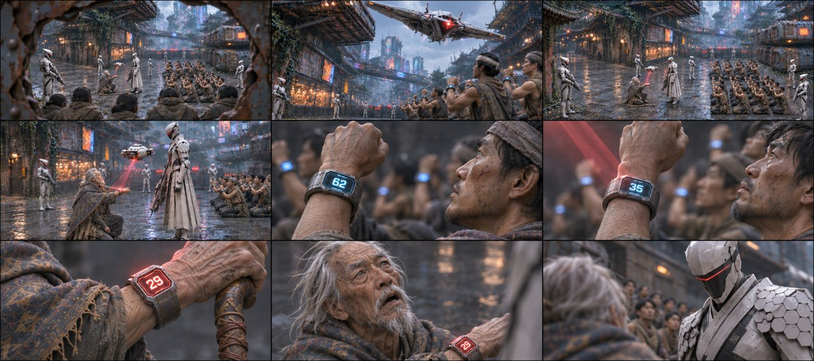
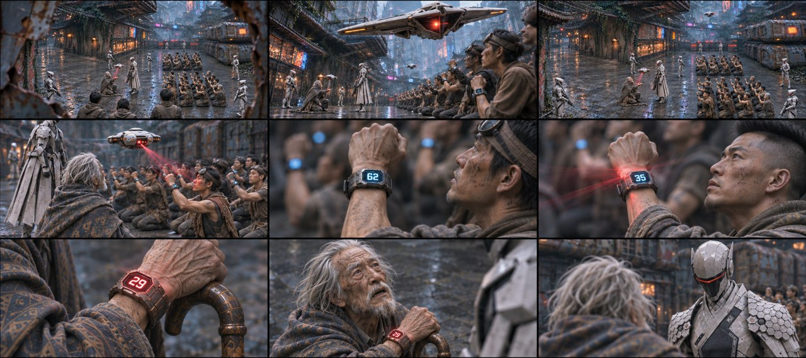

# B02-G01 · 封巷扫描与红色29

制作中：本组已完成3/5张，当前仅列真实可下载的图。

[返回全部组](../E01_ORIGINAL_V3_PREVIEW.md)

## 候选01 · 正侧交代

[直接下载PNG](https://github.com/liu-ai-cmd/LIU/raw/refs/heads/storyboard-downloads/images/E01_ORIGINAL_V3/E01-B02-G01-I01.png)

重构后九格完整，原站位中左门、老者、右队列可辨；62、35、红29顺序正确，近景衣物与手部可读。实际1881×836，近似21:9约3.6%偏差；远景人数和无人机造型不作精确验收。

## 候选02 · 略低机位

[直接下载PNG](https://github.com/liu-ai-cmd/LIU/raw/refs/heads/storyboard-downloads/images/E01_ORIGINAL_V3/E01-B02-G01-I02.png)

九格已逐格目视，剧情顺序与本组首张相同，机位和局部距离有变化，无黑格；人物与物件未见明显新增错误。静态颤动、远景人数和细小铭牌仍不可精确验收；1881×836为近似21:9。

## 候选03 · 斜俯观察

[直接下载PNG](https://github.com/liu-ai-cmd/LIU/raw/refs/heads/storyboard-downloads/images/E01_ORIGINAL_V3/E01-B02-G01-I03.png)

九格已目视，巷内空间与队形、机A、封巷、机B、蓝62、蓝35、红29、老者抬头、队长反打顺序一致。无人机B与原横翼形制有近似；远处人数不可精确辨认。 本图1881×836，为近似21:9（约3.6%偏差），未拉伸或裁切PNG。

## 该组完整原文

△ 镜头穿越缝隙，来到距离铁皮屋2米外的窄巷。前景是几十个跪地贫民的身影。
高空俯拍全景，1架白色无人机(A)近机位掠过，执行官队长率领七名执行官封死窄巷，
仰拍无人机（B）发出猩红色的扫描激光束，红光挨个扫过跪地贫民高举的手腕。
俯拍特写一双双手腕：【命运值：62】【命运值：35】，最后停在老者手腕上，跳出刺眼的红字：【命运值：29】！镜头上移近景跟拍老者（惊恐抬头，刚张开嘴）：饶——
