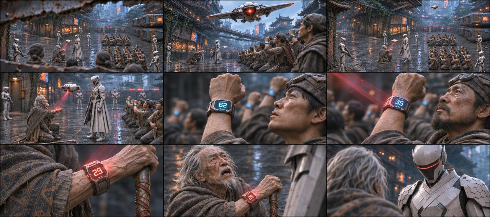
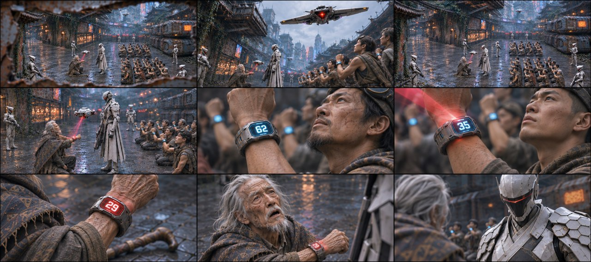
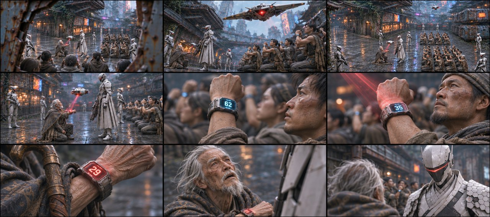

# B02-G01 · 封巷扫描与红色29

5张完整九宫格，同组九格阅读顺序一致，均为审核稿。

[返回全部11组](../E01_ORIGINAL_V3_PREVIEW.md) · [下载所在独立包](https://github.com/liu-ai-cmd/LIU/raw/refs/heads/storyboard-downloads/E01_ORIGINAL_V3_B02.zip)

|图号|机位候选|PNG原图|

|---|---|---|

|图01|正侧交代|[直接下载PNG](https://github.com/liu-ai-cmd/LIU/raw/refs/heads/storyboard-downloads/images/E01_ORIGINAL_V3/E01-B02-G01-I01.png)|

|图02|略低机位|[直接下载PNG](https://github.com/liu-ai-cmd/LIU/raw/refs/heads/storyboard-downloads/images/E01_ORIGINAL_V3/E01-B02-G01-I02.png)|

|图03|斜俯观察|[直接下载PNG](https://github.com/liu-ai-cmd/LIU/raw/refs/heads/storyboard-downloads/images/E01_ORIGINAL_V3/E01-B02-G01-I03.png)|

|图04|过肩反应|[直接下载PNG](https://github.com/liu-ai-cmd/LIU/raw/refs/heads/storyboard-downloads/images/E01_ORIGINAL_V3/E01-B02-G01-I04.png)|

|图05|远近对照|[直接下载PNG](https://github.com/liu-ai-cmd/LIU/raw/refs/heads/storyboard-downloads/images/E01_ORIGINAL_V3/E01-B02-G01-I05.png)|

## 图01 · 正侧交代

重构后九格完整，原站位中左门、老者、右队列可辨；62、35、红29顺序正确，近景衣物与手部可读。实际1881×836，近似21:9约3.6%偏差；远景人数和无人机造型不作精确验收。

## 图02 · 略低机位

九格已逐格目视，剧情顺序与本组首张相同，机位和局部距离有变化，无黑格；人物与物件未见明显新增错误。静态颤动、远景人数和细小铭牌仍不可精确验收；1881×836为近似21:9。

## 图03 · 斜俯观察

九格已目视，巷内空间与队形、机A、封巷、机B、蓝62、蓝35、红29、老者抬头、队长反打顺序一致。无人机B与原横翼形制有近似；远处人数不可精确辨认。 本图1881×836，为近似21:9（约3.6%偏差），未拉伸或裁切PNG。

## 图04 · 过肩反应

九格已目视，检查巷两块队列、无人机、队长与老者关系、蓝62/35与红29及老者抬头次序正确。无人机B外形与原横翼有近似；远景人数不作逐人验收。 实际1881×836，为近似21:9；PNG未经拉伸或裁切。

## 图05 · 远近对照

九格已目视，检查巷两块队列、无人机、队长与老者关系、蓝62/35与红29及老者抬头次序正确。无人机B外形与原横翼有近似；远景人数不作逐人验收。 实际1881×836，为近似21:9；PNG未经拉伸或裁切。

## 九格剧情顺序

### 全剧010 · 穿缝见巷

从铁皮裂缝外侧观看检查巷，近处金属边框与跪着的贫民背影构成前景，左侧藏身门和右侧两块队列可定位。

### 全剧011 · 机A掠过

白色薄横翼无人机A从近机位上方掠过，中央红灯清楚，背景保留右侧跪地队列和空中走管。

### 全剧012 · 队长封巷

唯一白长披甲的队长率白短甲执行官占住出口；侧向空间镜交代左门、老者、队长、右队列，人数远处不靠复制角色板增加。

### 全剧013 · 机B扫描

无人机B在跪地贫民上方停住，红光向下扫过高举的手腕；老者跪位与队长真实站位不互换。

### 全剧014 · 腕屏62

一名成年贫民举起手腕，腕屏蓝色62占焦点，衣袖及背景队列只是身份关系，没有石头蓝31。

### 全剧015 · 腕屏35

另一名成年贫民的腕屏为蓝色35，红扫描光掠过金属腕带；与上一位是不同成人。

### 全剧016 · 老者29

白发老者的干瘦手腕亮起红色29，拐杖和粗旧深灰披衣边缘可辨；其他数字不混入。

### 全剧017 · 老者抬头

老者保持跪姿，沿自身手腕慢慢抬起头，视线看向站在面前右侧的队长，不突然转身。

### 全剧018 · 队长冷视

队长头盔微低，红色细面罩朝老者，老者肩背在前景。背景随反打为右侧队列与巷壁，禁止把左门硬搬至不合透视位置。

展开该组完整原文

△ 镜头穿越缝隙，来到距离铁皮屋2米外的窄巷。前景是几十个跪地贫民的身影。
高空俯拍全景，1架白色无人机(A)近机位掠过，执行官队长率领七名执行官封死窄巷，
仰拍无人机（B）发出猩红色的扫描激光束，红光挨个扫过跪地贫民高举的手腕。
俯拍特写一双双手腕：【命运值：62】【命运值：35】，最后停在老者手腕上，跳出刺眼的红字：【命运值：29】！镜头上移近景跟拍老者（惊恐抬头，刚张开嘴）：饶——

