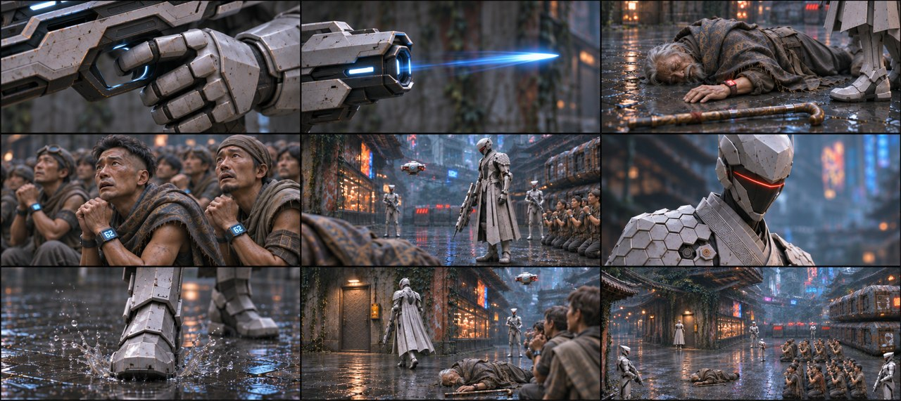
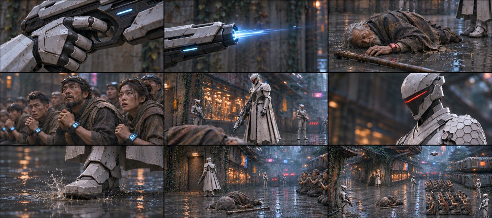

# B02-G02 · 老者倒地与队长逼近

5张完整九宫格，同组九格阅读顺序一致，均为审核稿。

[返回全部11组](../E01_ORIGINAL_V3_PREVIEW.md) · [下载所在独立包](https://github.com/liu-ai-cmd/LIU/raw/refs/heads/storyboard-downloads/E01_ORIGINAL_V3_B02.zip)

|图号|机位候选|PNG原图|

|---|---|---|

|图01|正侧交代|[直接下载PNG](https://github.com/liu-ai-cmd/LIU/raw/refs/heads/storyboard-downloads/images/E01_ORIGINAL_V3/E01-B02-G02-I01.png)|

|图02|略低机位|[直接下载PNG](https://github.com/liu-ai-cmd/LIU/raw/refs/heads/storyboard-downloads/images/E01_ORIGINAL_V3/E01-B02-G02-I02.png)|

|图03|斜俯观察|[直接下载PNG](https://github.com/liu-ai-cmd/LIU/raw/refs/heads/storyboard-downloads/images/E01_ORIGINAL_V3/E01-B02-G02-I03.png)|

|图04|过肩反应|[直接下载PNG](https://github.com/liu-ai-cmd/LIU/raw/refs/heads/storyboard-downloads/images/E01_ORIGINAL_V3/E01-B02-G02-I04.png)|

|图05|远近对照|[直接下载PNG](https://github.com/liu-ai-cmd/LIU/raw/refs/heads/storyboard-downloads/images/E01_ORIGINAL_V3/E01-B02-G02-I05.png)|

## 图01 · 正侧交代

九格已目视：器械扳机、空枪光、完整衣物倒地结果、成年群众反应、收枪、命令、靴落、近门、门外关系分别表现。未画人体受击过程，群众无石头误入。近门格采用移动相位，精确人数远景不可辨。

## 图02 · 略低机位

九格已逐格目视，剧情顺序与本组首张相同，机位和局部距离有变化，无黑格；人物与物件未见明显新增错误。静态颤动、远景人数和细小铭牌仍不可精确验收；1881×836为近似21:9。

## 图03 · 斜俯观察

九格已目视：扳机、空枪光、老者完整衣物倒地、成人群众反应、收枪、命令、迈靴、近门、阴影结束。未见石头误入人群；小腕屏背景出现其他数值，不代表对原文数值的精准复刻。 本图1881×836，为近似21:9（约3.6%偏差），未拉伸或裁切PNG。

## 图04 · 过肩反应

已目视九格：角落镜头数字已清理，腕屏画内62保留；成人老者倒地结果、队长披风、贫民分组和走向可读，无石头误入室外。

## 图05 · 远近对照

九格已目视，成年人员器械、空枪光、老者倒地结果、成年群众反应、收枪、口令、战靴和近门关系相接；石头没有误入群众，人体受击留画外。 实际1881×836，为近似21:9；PNG未经拉伸或裁切。

## 九格剧情顺序

### 全剧019 · 机械指扣动

只拍成年队长白甲手套和能量枪的扳机局部，手指完成扣动；镜头背景是空巷壁，没有人体和被瞄准对象。

### 全剧020 · 枪光离口

只拍枪口和划过空巷的短促蓝光，所有人物在画外，不画射线接触任何人。

### 全剧021 · 老者倒地

过渡后的既定结果：老者侧躺在原位置附近湿地，披衣完整、无伤口细节，拐杖落在身旁，队长靴缘位于远景。

### 全剧022 · 贫民惊惧

右侧队列中几位成年陌生贫民缩肩惊恐，保持跪姿和原行列，不能出现石头、玄初或蓝31腕码。

### 全剧023 · 队长收枪

队长在原站位将能量枪口降下，老者倒地的披衣边缘可作前景，人与器械不发生新的接触事件。

### 全剧024 · 机械命令

队长头盔面罩近景，头部朝队列，衣甲冷白，口令保持机械冷淡，不加入字幕。

### 全剧025 · 战靴迈下

金属靴落在空湿地上，泥水向两侧泛起细点，本格地面没有人体。

### 全剧026 · 走近尸侧

从侧后方跟到队长背后，完整披甲沿老者倒地位置边缘走向左侧藏身门；保持可通行路径，不踩穿人物。

### 全剧027 · 门外阴影

队长高大的影子停近藏身铁门，门板仍闭；右侧队列远处维持原布局，老者位置未复活。

展开该组完整原文

△ 砰！枪口发出高频射线。
前景老者背影，高频射线当场洞穿老者胸口！老者倒地后，背景是开完枪状态执行官队长，周围还有一堆惊恐的贫民（贫民位置和前面剧情一致）。
前景背景是难民，侧面跟拍中景的执行官队长（垂下枪口，机械音）：命运值低于30点，就地抹除。下一个！
他边说边迈着沉重的金属战靴踩过泥血，摇镜到执行官队长身后，展示他一步步逼近老者的尸体！

