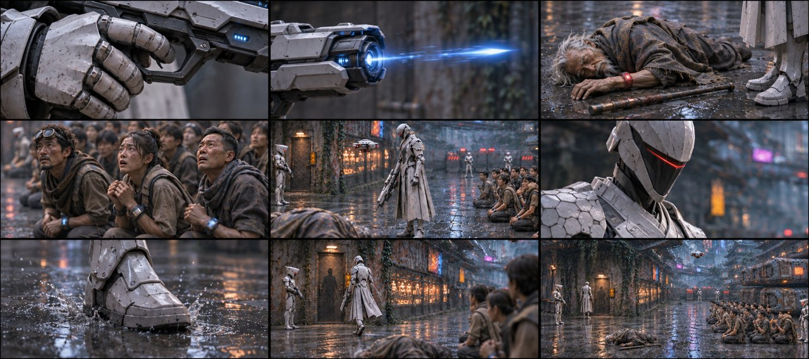
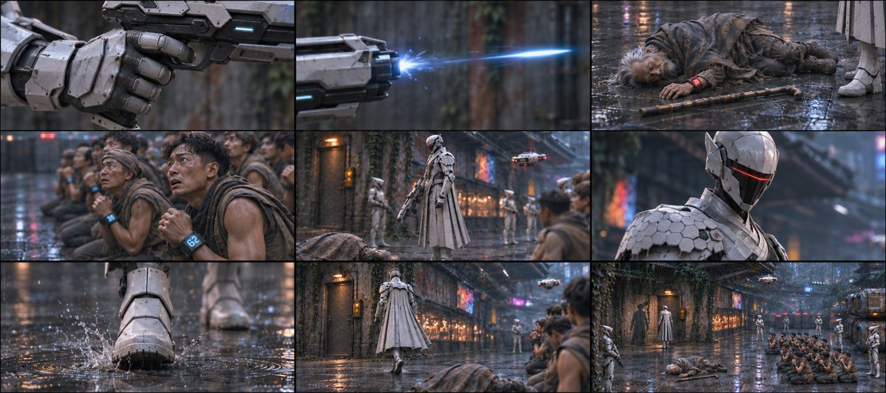
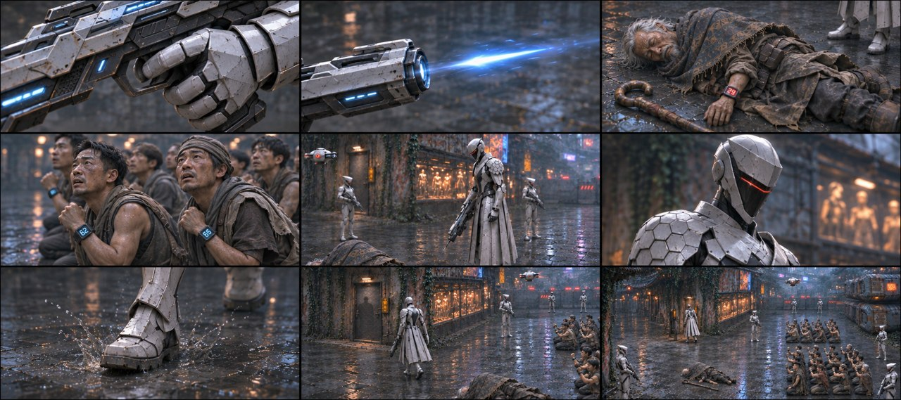

# B02-G02 · 老者倒地与队长逼近

制作中：本组已完成3/5张，当前仅列真实可下载的图。

[返回全部组](../E01_ORIGINAL_V3_PREVIEW.md)

## 候选01 · 正侧交代

[直接下载PNG](https://github.com/liu-ai-cmd/LIU/raw/refs/heads/storyboard-downloads/images/E01_ORIGINAL_V3/E01-B02-G02-I01.png)

九格已目视：器械扳机、空枪光、完整衣物倒地结果、成年群众反应、收枪、命令、靴落、近门、门外关系分别表现。未画人体受击过程，群众无石头误入。近门格采用移动相位，精确人数远景不可辨。

## 候选02 · 略低机位

[直接下载PNG](https://github.com/liu-ai-cmd/LIU/raw/refs/heads/storyboard-downloads/images/E01_ORIGINAL_V3/E01-B02-G02-I02.png)

九格已逐格目视，剧情顺序与本组首张相同，机位和局部距离有变化，无黑格；人物与物件未见明显新增错误。静态颤动、远景人数和细小铭牌仍不可精确验收；1881×836为近似21:9。

## 候选03 · 斜俯观察

[直接下载PNG](https://github.com/liu-ai-cmd/LIU/raw/refs/heads/storyboard-downloads/images/E01_ORIGINAL_V3/E01-B02-G02-I03.png)

九格已目视：扳机、空枪光、老者完整衣物倒地、成人群众反应、收枪、命令、迈靴、近门、阴影结束。未见石头误入人群；小腕屏背景出现其他数值，不代表对原文数值的精准复刻。 本图1881×836，为近似21:9（约3.6%偏差），未拉伸或裁切PNG。

## 该组完整原文

△ 砰！枪口发出高频射线。
前景老者背影，高频射线当场洞穿老者胸口！老者倒地后，背景是开完枪状态执行官队长，周围还有一堆惊恐的贫民（贫民位置和前面剧情一致）。
前景背景是难民，侧面跟拍中景的执行官队长（垂下枪口，机械音）：命运值低于30点，就地抹除。下一个！
他边说边迈着沉重的金属战靴踩过泥血，摇镜到执行官队长身后，展示他一步步逼近老者的尸体！
