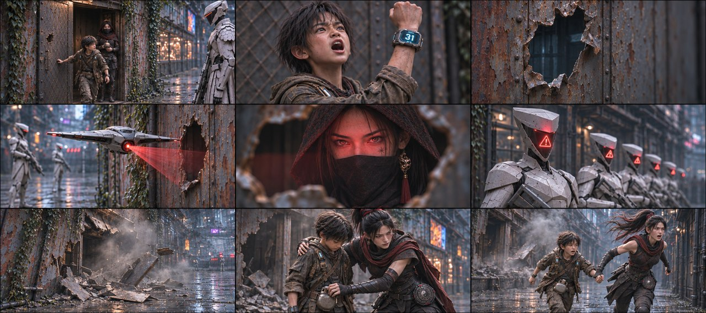

# B02-G03 · 石头出门与漏洞暴露

制作中：本组已完成1/5张，当前仅列真实可下载的图。

[返回全部组](../E01_ORIGINAL_V3_PREVIEW.md)

## 候选01 · 正侧交代

[直接下载PNG](https://github.com/liu-ai-cmd/LIU/raw/refs/heads/storyboard-downloads/images/E01_ORIGINAL_V3/E01-B02-G03-I01.png)

九格已目视：出门与关门中间相位、举31、空孔、机降扫描、屋内玄初、面罩红警、毁坏空屋、护人扣壶、露面拉臂逃离。第1格可见门内玄初，非已随石头出屋；空孔和毁屋结果替代挥拳/爆炸实施。画幅修正后1881×836。 本图1881×836，为近似21:9（约3.6%偏差），未拉伸或裁切PNG。

## 该组完整原文

冲出铁皮屋（顺手关上门），石头（高举着亮起划蓝光【31点】的手腕，大喊）：别开枪！这儿就我一个！我有31点！
△ 铁皮屋内看（玄初还在屋内），执行官队长收回拳头，留下一个大洞，半空中的猎犬无人机落下，红光透过大洞，
红光直接锁死屋内阴影里的玄初！
△ 中景希区柯克快速变焦特写，在场所有执行官的面罩同时爆闪刺目红色警报，红色警报在七张面罩上一块块亮起来。
数道高频射线同时将破铁皮屋轰得粉碎，铁片炸飞！执行官队长（举枪锁定玄初，机械音）：警报！发现系统漏洞，就地抹除！
△ 玄初从火光中扑出，护住石头，转身拽着的胳膊，冲进后方的狭窄暗巷！玄初（厉声）：跑！
