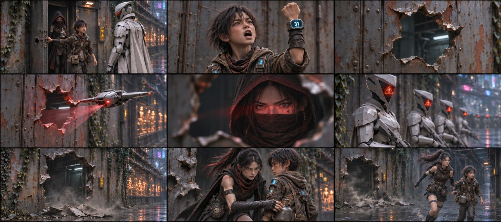
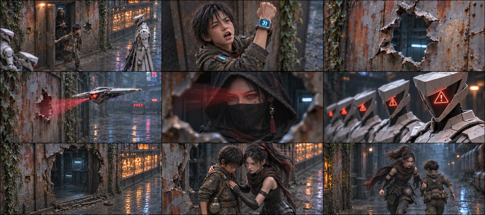
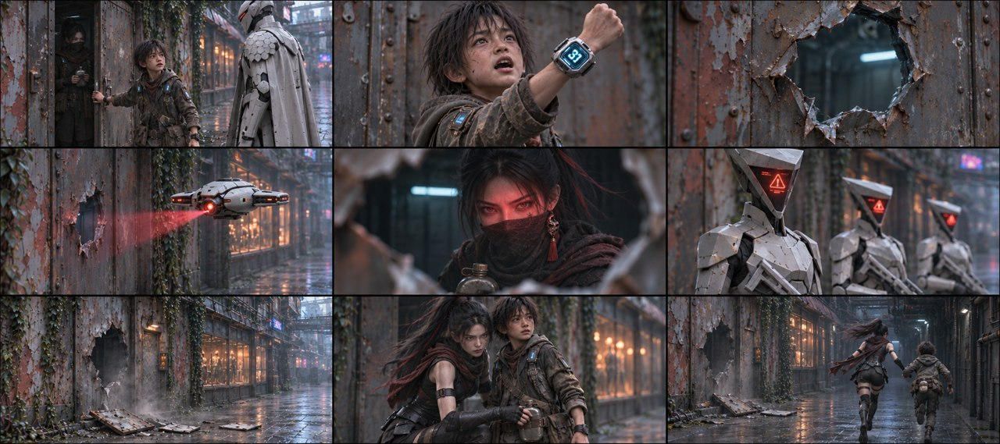
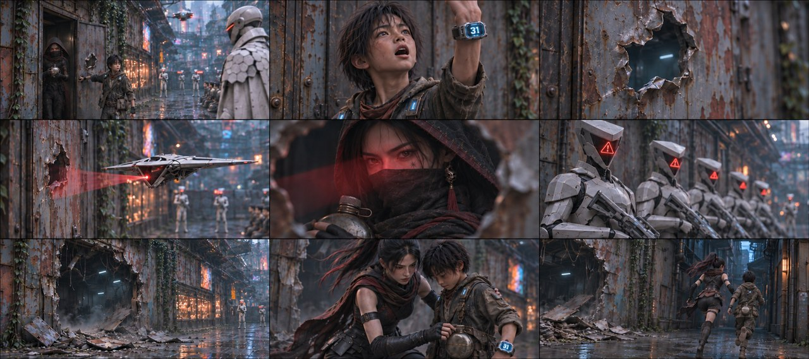

# B02-G03 · 石头出门与漏洞暴露

5张完整九宫格，同组九格阅读顺序一致，均为审核稿。

[返回全部11组](../E01_ORIGINAL_V3_PREVIEW.md) · [下载所在独立包](https://github.com/liu-ai-cmd/LIU/raw/refs/heads/storyboard-downloads/E01_ORIGINAL_V3_B02.zip)

|图号|机位候选|PNG原图|

|---|---|---|

|图01|正侧交代|[直接下载PNG](https://github.com/liu-ai-cmd/LIU/raw/refs/heads/storyboard-downloads/images/E01_ORIGINAL_V3/E01-B02-G03-I01.png)|

|图02|略低机位|[直接下载PNG](https://github.com/liu-ai-cmd/LIU/raw/refs/heads/storyboard-downloads/images/E01_ORIGINAL_V3/E01-B02-G03-I02.png)|

|图03|斜俯观察|[直接下载PNG](https://github.com/liu-ai-cmd/LIU/raw/refs/heads/storyboard-downloads/images/E01_ORIGINAL_V3/E01-B02-G03-I03.png)|

|图04|过肩反应|[直接下载PNG](https://github.com/liu-ai-cmd/LIU/raw/refs/heads/storyboard-downloads/images/E01_ORIGINAL_V3/E01-B02-G03-I04.png)|

|图05|远近对照|[直接下载PNG](https://github.com/liu-ai-cmd/LIU/raw/refs/heads/storyboard-downloads/images/E01_ORIGINAL_V3/E01-B02-G03-I05.png)|

## 图01 · 正侧交代

九格已目视：出门与关门中间相位、举31、空孔、机降扫描、屋内玄初、面罩红警、毁坏空屋、护人扣壶、露面拉臂逃离。第1格可见门内玄初，非已随石头出屋；空孔和毁屋结果替代挥拳/爆炸实施。画幅修正后1881×836。 本图1881×836，为近似21:9（约3.6%偏差），未拉伸或裁切PNG。

## 图02 · 略低机位

已目视九格：第1格室内玄初恢复兜帽面纱，第5格仍戴面纱，第8/9格逃出后降至颈部；水壶、31腕屏、独立门洞与警报、空屋废墟、逃跑顺序完整。

## 图03 · 斜俯观察

已目视最终编辑：九格边角小号镜头数字已清除；31画内腕屏保留。第6格红色警报头肩近景、第7格无人旧屋门洞；玄初第1/5格帽纱一致、逃出后面纱降至颈部。第8格水壶已扣在石头腰间，成人手在衣领附近，作为交接完成关键帧。九格均有内容，原始射击毁屋动作另存文本。

## 图04 · 过肩反应

九格已目视，出门/关门中间相位、举31、空孔、机降、屋内女主、面罩红警、毁屋结果、护人扣壶和逃离相接；第1格女主仍在门内，之后帽/面纱在逃出时落颈。 实际1881×836，为近似21:9；PNG未经拉伸或裁切。

## 图05 · 远近对照

已目视九格：第1格室内玄初恢复兜帽面纱，与第5格一致；后续逃跑卸下面纱，水壶扣回腰带有交接画面；无空格。

## 九格剧情顺序

### 全剧037 · 石头关门

石头从左侧藏身门跨出，回手拉上门板。队长仍在外侧，玄初留在门内，本格不要把她画在群众里。

### 全剧038 · 举31证明

石头举起蓝31腕码，仰头喊话；画面只取石头和门板，器械与队长在画外。

### 全剧039 · 拳套收回

局部画白甲闭拳从不规则锈孔向外退，留下空孔；只拍手套和金属板，不画新的身体接触。

### 全剧040 · 无人机下降

白色薄横翼无人机从门外降至拳孔高度，中央红光朝孔内照去，不能变成带嘴的动物。

### 全剧041 · 红光发现玄初

从孔外朝内取景，门内玄初戴帽面纱，红光只落在她的眼部，石头保持在屋外画外。

### 全剧042 · 面罩报警

一列成年白甲执行官的面罩依次亮起红色警报图形，人物站位仍属于检查巷，少年在画外，不画开火目标。

### 全剧043 · 铁屋崩解

取空建筑外墙的炸裂与铁片飞起，画中只留建筑和烟尘，人体全部在画外；用独立空景表现破屋结果。

### 全剧044 · 玄初护住石头

玄初从已破的门侧到石头身旁，侧身把他护在怀侧。为跟随后文同一只水壶从石头身上掉落的因果，玄初自己的左手把壶扣回石头腰带，作为明确标注的补充衔接。

### 全剧045 · 拉臂逃离

玄初自己的右手握住石头左前臂，带他进入后方暗巷；玄初左手空出，原屋已是毁坏态，水壶留石头腰带，不增加群众跟跑。

展开该组完整原文

冲出铁皮屋（顺手关上门），石头（高举着亮起划蓝光【31点】的手腕，大喊）：别开枪！这儿就我一个！我有31点！
△ 铁皮屋内看（玄初还在屋内），执行官队长收回拳头，留下一个大洞，半空中的猎犬无人机落下，红光透过大洞，
红光直接锁死屋内阴影里的玄初！
△ 中景希区柯克快速变焦特写，在场所有执行官的面罩同时爆闪刺目红色警报，红色警报在七张面罩上一块块亮起来。
数道高频射线同时将破铁皮屋轰得粉碎，铁片炸飞！执行官队长（举枪锁定玄初，机械音）：警报！发现系统漏洞，就地抹除！
△ 玄初从火光中扑出，护住石头，转身拽着的胳膊，冲进后方的狭窄暗巷！玄初（厉声）：跑！

