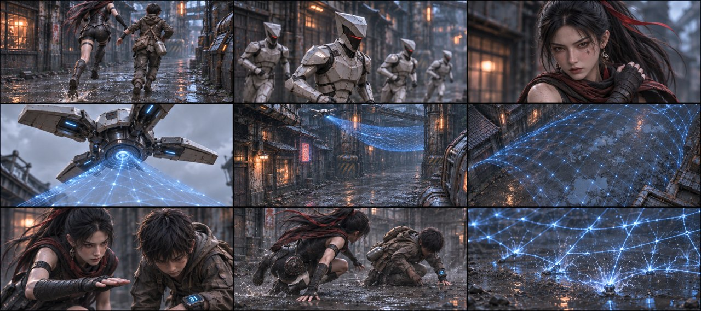

# B03-G01 · 奔逃与电网迫近

制作中：本组已完成2/5张，当前仅列真实可下载的图。

[返回全部组](../E01_ORIGINAL_V3_PREVIEW.md)

## 候选01 · 正侧交代

[直接下载PNG](https://github.com/liu-ai-cmd/LIU/raw/refs/heads/storyboard-downloads/images/E01_ORIGINAL_V3/E01-B03-G01-I01.png)

九格已目视：奔跑、后方器械、缩肩、网包离口、飞包、空巷展网、手按头、扑低、网落泥坑分开。4名追兵近处可辨，微小远景人数未精确验收；机翼和腕码依原资产近似。实际1879×837，接近目标但约3.8%比例偏差，无拉伸。玄初已经露面，帽/面纱落颈后作为制作衔接。

## 候选02 · 略低机位

[直接下载PNG](https://github.com/liu-ai-cmd/LIU/raw/refs/heads/storyboard-downloads/images/E01_ORIGINAL_V3/E01-B03-G01-I02.png)

九格已目视：奔跑、追兵肩甲、成人肩部反应、独立部署器、空中网包/网、展开、下压手势、扑低相位、空网触地。枪举起与手按头用不接触手势转述，部署器被生成成悬空机具，原文手执网枪未精确实现；未画人体受击。 本图1881×836，为近似21:9（约3.6%偏差），未拉伸或裁切PNG。

## 该组完整原文

巷道里，玄初拽着石头狂奔，镜头贴地在两人脚边前推。后方四名执行官端枪齐射，高频激光贴着两人后背炸开一串火花，一道擦破玄初左肩，带起一串血花。
一名执行官持枪射向两人逃跑的前方高空出高压电网
电网飞到两人逃跑的上方，当头向两人罩下。
升格镜头，展示电网距离两人仅剩几寸，网格在红光下发亮。
玄初猛地摁下石头脑袋，两人同时扑倒翻滚。
刺啦——高压电网擦着身体钉入地面泥坑，炸开大片蓝电火花。
