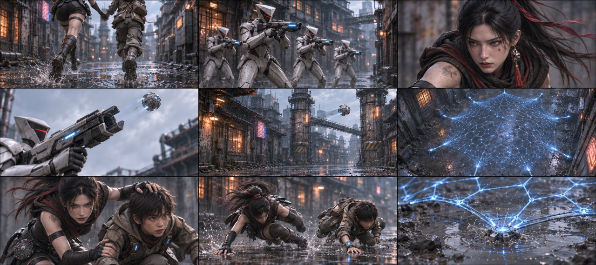
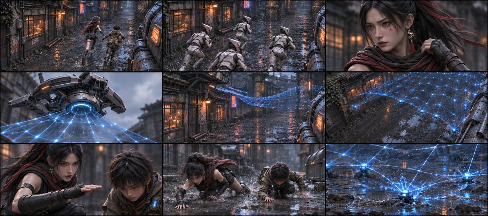
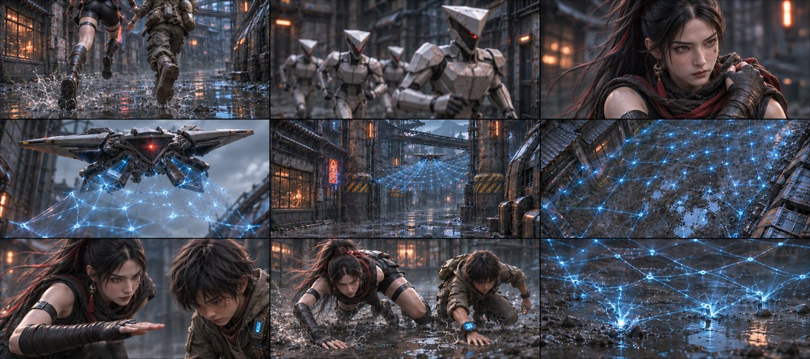
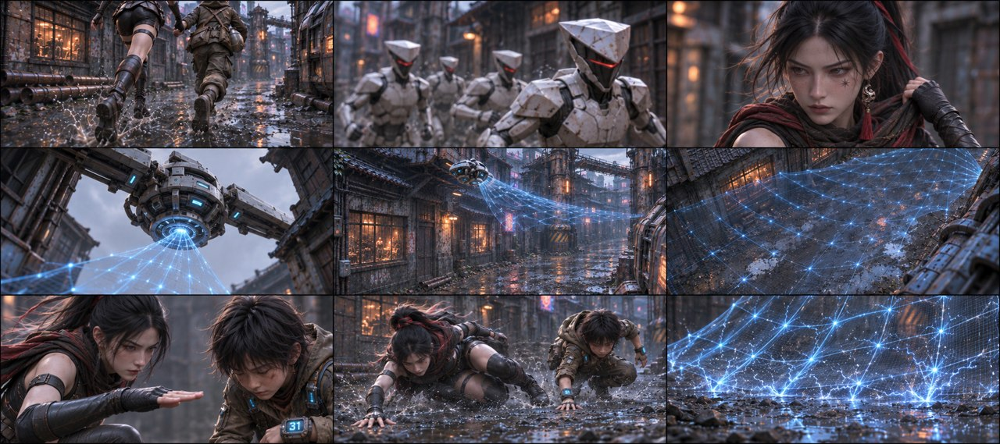

# B03-G01 · 奔逃与电网迫近

5张完整九宫格，同组九格阅读顺序一致，均为审核稿。

[返回全部11组](../E01_ORIGINAL_V3_PREVIEW.md) · [下载所在独立包](https://github.com/liu-ai-cmd/LIU/raw/refs/heads/storyboard-downloads/E01_ORIGINAL_V3_B03A.zip)

|图号|机位候选|PNG原图|

|---|---|---|

|图01|正侧交代|[直接下载PNG](https://github.com/liu-ai-cmd/LIU/raw/refs/heads/storyboard-downloads/images/E01_ORIGINAL_V3/E01-B03-G01-I01.png)|

|图02|略低机位|[直接下载PNG](https://github.com/liu-ai-cmd/LIU/raw/refs/heads/storyboard-downloads/images/E01_ORIGINAL_V3/E01-B03-G01-I02.png)|

|图03|斜俯观察|[直接下载PNG](https://github.com/liu-ai-cmd/LIU/raw/refs/heads/storyboard-downloads/images/E01_ORIGINAL_V3/E01-B03-G01-I03.png)|

|图04|过肩反应|[直接下载PNG](https://github.com/liu-ai-cmd/LIU/raw/refs/heads/storyboard-downloads/images/E01_ORIGINAL_V3/E01-B03-G01-I04.png)|

|图05|远近对照|[直接下载PNG](https://github.com/liu-ai-cmd/LIU/raw/refs/heads/storyboard-downloads/images/E01_ORIGINAL_V3/E01-B03-G01-I05.png)|

## 图01 · 正侧交代

九格已目视：奔跑、后方器械、缩肩、网包离口、飞包、空巷展网、手按头、扑低、网落泥坑分开。4名追兵近处可辨，微小远景人数未精确验收；机翼和腕码依原资产近似。实际1879×837，接近目标但约3.8%比例偏差，无拉伸。玄初已经露面，帽/面纱落颈后作为制作衔接。

## 图02 · 略低机位

九格已目视：奔跑、追兵肩甲、成人肩部反应、独立部署器、空中网包/网、展开、下压手势、扑低相位、空网触地。枪举起与手按头用不接触手势转述，部署器被生成成悬空机具，原文手执网枪未精确实现；未画人体受击。 本图1881×836，为近似21:9（约3.6%偏差），未拉伸或裁切PNG。

## 图03 · 斜俯观察

已目视九格：第1/2格原站位白箭头均已清除，画面自然补齐。奔跑、追兵、成人肩部反应、电网装置/空巷、电网近景、手势、伏地、落网连续。装置造型由原手持改空中装置，已记录。

## 图04 · 过肩反应

已目视九格：第1格白箭头清除；奔跑、追兵、肩部反应、独立放网、空巷、电网、向下手势、伏地、落网均完整。无人机代放网装置与原文差异已记录。

## 图05 · 远近对照

九格已目视，奔跑、追兵肩甲、成人肩部反应、空中部署器/展网、手势压低、扑低和触地网相接。手执网枪被转述为独立悬空机具，身体受击及手按头采用克制手势，不冒称逐字绘制原动作。 实际1881×836，为近似21:9；PNG未经拉伸或裁切。

## 九格剧情顺序

### 全剧046 · 贴地奔跑

贴地取二人踩过湿巷的脚步，女主在同伴左侧，手臂连接关系可从上缘辨认，右转口在前方。

### 全剧047 · 后方举枪

只拍后方四名成年短甲执行官举起科幻设备的独立镜头，朝向一段空巷，二位同伴不在画面。

### 全剧048 · 玄初缩肩

玄初单人近景，左肩向内缩紧，布料留一道暗擦痕，无伤口或出血形成细节；同伴与设备全在画外。

### 全剧049 · 网包离口

仰拍成年人员机械部署器的前端，折叠网包离开前缘向日间空中飞去，人物目标全部画外。

### 全剧050 · 网包升空

机械网包在两墙之间空中移动，建筑、柱A和柱B给高度尺度，画面没有人。

### 全剧051 · 蓝网展开

只画空巷上方展开的高压蓝网，下方是空湿地和泥坑，所有人物画外，用张开结构表示逼近。

### 全剧052 · 摁低头部

玄初自己的左手轻按石头发顶，右手仍扶其左前臂，二人开始压低身体；画面内不出现网或武器。

### 全剧053 · 二人扑滚

二人朝同一前进方向扑低后翻滚，分别的支撑手和膝接触地面，不画网接触身体。

### 全剧054 · 网钉泥坑

空泥坑中的蓝网触地张开，电光照亮水面，二人已经在本格画外，没有人体伤害细节。

展开该组完整原文

巷道里，玄初拽着石头狂奔，镜头贴地在两人脚边前推。后方四名执行官端枪齐射，高频激光贴着两人后背炸开一串火花，一道擦破玄初左肩，带起一串血花。
一名执行官持枪射向两人逃跑的前方高空出高压电网
电网飞到两人逃跑的上方，当头向两人罩下。
升格镜头，展示电网距离两人仅剩几寸，网格在红光下发亮。
玄初猛地摁下石头脑袋，两人同时扑倒翻滚。
刺啦——高压电网擦着身体钉入地面泥坑，炸开大片蓝电火花。

