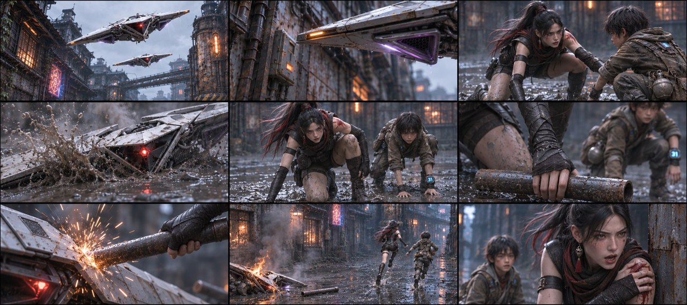
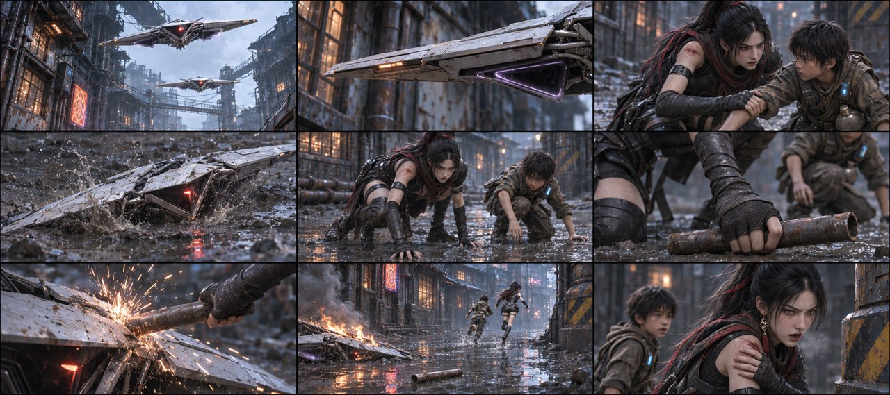
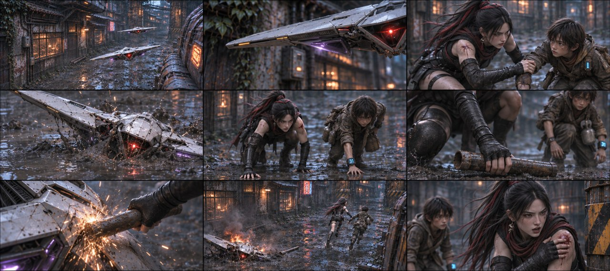
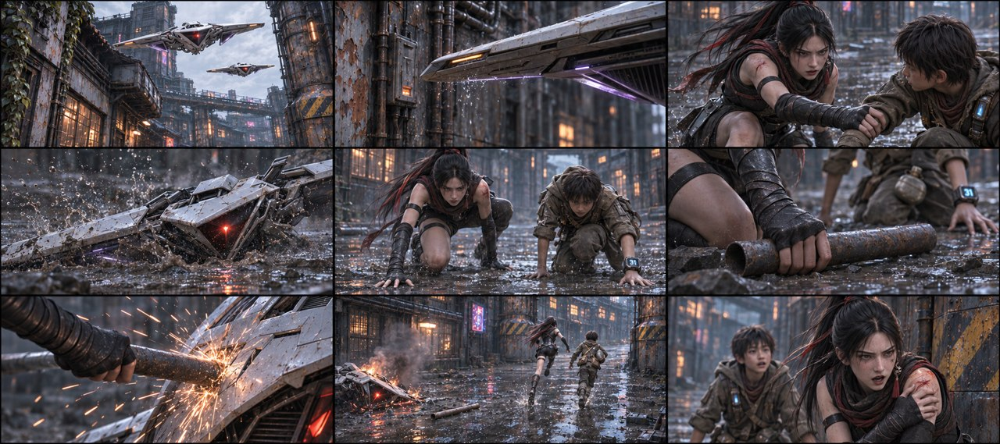
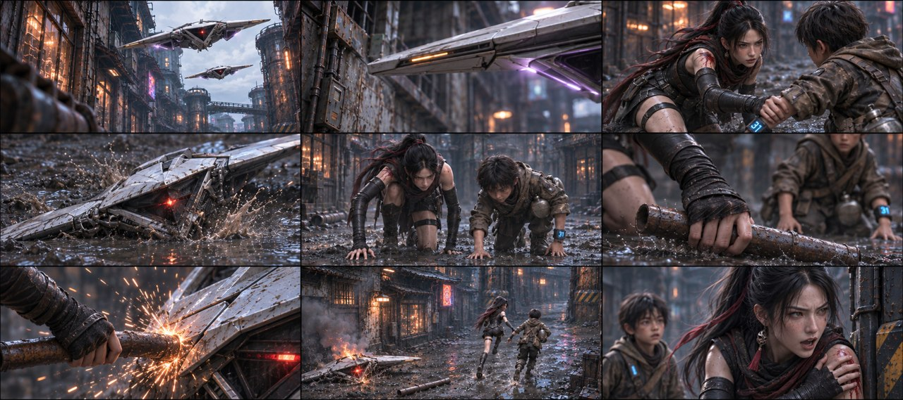

# B03-G02 · 躲开机翼与铁管反击

5张完整九宫格，同组九格阅读顺序一致，均为审核稿。

[返回全部11组](../E01_ORIGINAL_V3_PREVIEW.md) · [下载所在独立包](https://github.com/liu-ai-cmd/LIU/raw/refs/heads/storyboard-downloads/E01_ORIGINAL_V3_B03A.zip)

|图号|机位候选|PNG原图|

|---|---|---|

|图01|正侧交代|[直接下载PNG](https://github.com/liu-ai-cmd/LIU/raw/refs/heads/storyboard-downloads/images/E01_ORIGINAL_V3/E01-B03-G02-I01.png)|

|图02|略低机位|[直接下载PNG](https://github.com/liu-ai-cmd/LIU/raw/refs/heads/storyboard-downloads/images/E01_ORIGINAL_V3/E01-B03-G02-I02.png)|

|图03|斜俯观察|[直接下载PNG](https://github.com/liu-ai-cmd/LIU/raw/refs/heads/storyboard-downloads/images/E01_ORIGINAL_V3/E01-B03-G02-I03.png)|

|图04|过肩反应|[直接下载PNG](https://github.com/liu-ai-cmd/LIU/raw/refs/heads/storyboard-downloads/images/E01_ORIGINAL_V3/E01-B03-G02-I04.png)|

|图05|远近对照|[直接下载PNG](https://github.com/liu-ai-cmd/LIU/raw/refs/heads/storyboard-downloads/images/E01_ORIGINAL_V3/E01-B03-G02-I05.png)|

## 图01 · 正侧交代

九格已目视，双机/机翼、拉偏、卡泥、起身相位、抓管、击机、释放铁管跑开、催跑完整。第5格为撑地起身中间相位，非全站直；图中左肩有克制血痕，帽/面纱均在颈后。

## 图02 · 略低机位

九格已逐格目视，剧情顺序与本组首张相同，机位和局部距离有变化，无黑格；人物与物件未见明显新增错误。静态颤动、远景人数和细小铭牌仍不可精确验收；1881×836为近似21:9。

## 图03 · 斜俯观察

九格已目视：双机、翼缘、拉扶、卡泥、两人撑地、抓管、击机器、释放铁管跑开、催跑可辨。第5格为起身中间相位，女主左肩有克制旧痕，帽/面纱均落颈后；远处柱尺度为近似。 本图1881×836，为近似21:9（约3.6%偏差），未拉伸或裁切PNG。

## 图04 · 过肩反应

九格已目视，双机、翼缘、拉扶、卡泥、撑地起身相位、抓管、击机、放管跑开和催跑均可辨。肩部旧痕保留，遮挡下不能逐镜精确验收伤口侧别；下阶段视频需统一左肩。 实际1881×836，为近似21:9；PNG未经拉伸或裁切。

## 图05 · 远近对照

九格已目视，双机、翼缘、拉扶、卡泥、撑地起身相位、抓管、击机、放管跑开和催跑均可辨。肩部旧痕保留，遮挡下不能逐镜精确验收伤口侧别；下阶段视频需统一左肩。 实际1881×836，为近似21:9；PNG未经拉伸或裁切。

## 九格剧情顺序

### 全剧055 · 双机俯冲

仰拍两架原资产白色薄横翼无人机，中央红灯，机翼沿空巷下降；所有人物在画外。

### 全剧056 · 冷刃擦过

只取一架无人机翼缘掠过空巷墙面，边缘冷光清楚，画内没有任何人的颈部或身体。

### 全剧057 · 拉偏同伴

玄初用自己的右手把石头左前臂拉向自己，二人仍低伏；机翼和其他威胁全部画外，画核心可辨抓扶。

### 全剧058 · 机翼卡泥

空湿地里一架无人机的横翼卡进泥土，机身偏斜，泥水向外分开；不出现被击中的人体。

### 全剧059 · 撑地起身

玄初与石头从低伏姿势各用自己的手撑地起身，脚掌着地、重心向前，不能无支撑瞬间变站姿。

### 全剧060 · 捡起铁管

玄初自己的右手从地面抓起一截短旧铁管，石头保持已起身姿态在侧后，水壶还在其腰带。

### 全剧061 · 击中机器

只拍成年玄初的黑护臂手握铁管接触无人机外壳的局部，火花来自金属接触，没有其他人物。

### 全剧062 · 绕过拐角

铁管已从玄初右手释放在损坏无人机旁的湿地，二人跑过右转口，背景损坏无人机冒火。兜帽因奔跑滑落，面纱落到颈部，此后不再复戴，脸型与黑红护甲不变。

### 全剧063 · 玄初催跑

女主在右转口边微侧脸，自己的左手捂住衣物完整的左肩，右手空出，喘息说话；同伴在侧后而非突然换到前方。

展开该组完整原文

头顶两架无人机俯冲压下。冲向倒地的两人
最前方一架用机翼迎面直削石头咽喉，刃口在暗处拉出一道冷光。
千钧一发之际，玄初一把将石头拽偏半寸，飞机机翼卡入土里。
三个快切，两人从地面快速爬起，玄初顺势抡起地上一截短铁管，一挥砸爆卡在土里的无人机。
被砸无人机在背景发生爆炸，两人冲过拐角，火光在画框里被拉成一条尾迹。玄初：（捂着流血的左肩，喘息厉喝）前面就是巷口！冲出去！

