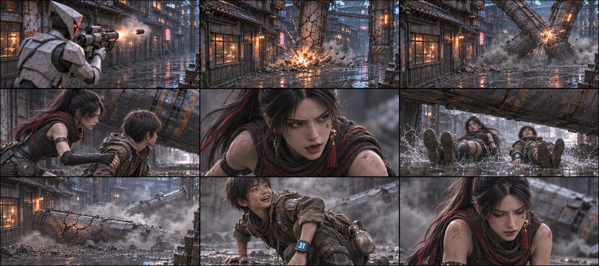
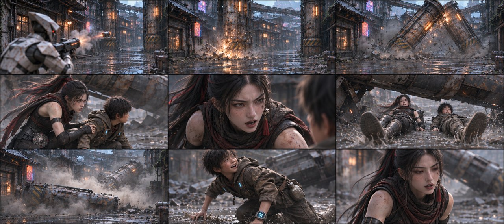
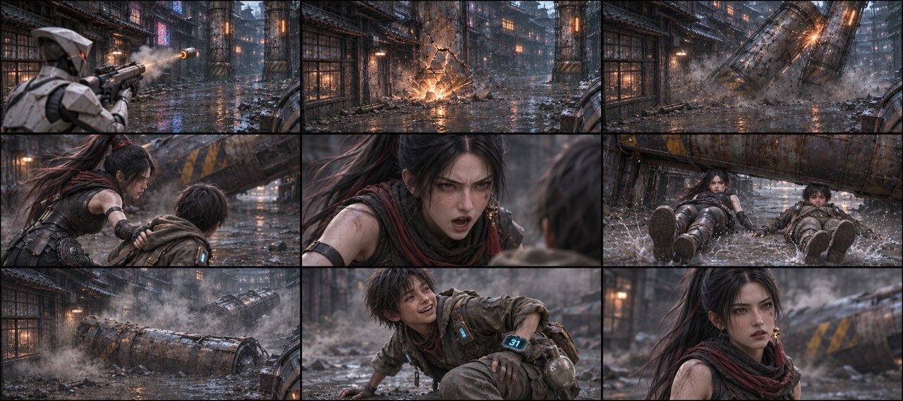
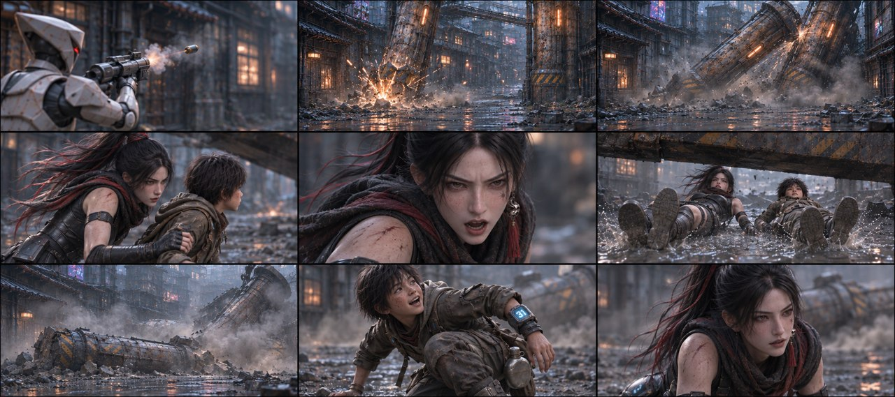
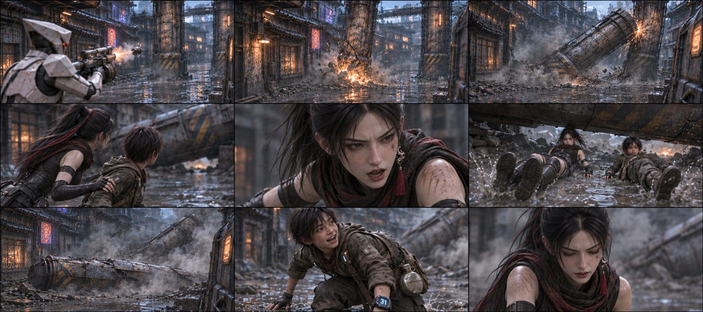

# B03-G03 · 倒柱封路与极限滑行

5张完整九宫格，同组九格阅读顺序一致，均为审核稿。

[返回全部11组](../E01_ORIGINAL_V3_PREVIEW.md) · [下载所在独立包](https://github.com/liu-ai-cmd/LIU/raw/refs/heads/storyboard-downloads/E01_ORIGINAL_V3_B03A.zip)

|图号|机位候选|PNG原图|

|---|---|---|

|图01|正侧交代|[直接下载PNG](https://github.com/liu-ai-cmd/LIU/raw/refs/heads/storyboard-downloads/images/E01_ORIGINAL_V3/E01-B03-G03-I01.png)|

|图02|略低机位|[直接下载PNG](https://github.com/liu-ai-cmd/LIU/raw/refs/heads/storyboard-downloads/images/E01_ORIGINAL_V3/E01-B03-G03-I02.png)|

|图03|斜俯观察|[直接下载PNG](https://github.com/liu-ai-cmd/LIU/raw/refs/heads/storyboard-downloads/images/E01_ORIGINAL_V3/E01-B03-G03-I03.png)|

|图04|过肩反应|[直接下载PNG](https://github.com/liu-ai-cmd/LIU/raw/refs/heads/storyboard-downloads/images/E01_ORIGINAL_V3/E01-B03-G03-I04.png)|

|图05|远近对照|[直接下载PNG](https://github.com/liu-ai-cmd/LIU/raw/refs/heads/storyboard-downloads/images/E01_ORIGINAL_V3/E01-B03-G03-I05.png)|

## 图01 · 正侧交代

编辑后第6格已为脚先向前的仰躺滑行，其他八格保持；双柱在后半维持倒地。两人动作仅为关键相位，1881×836约3.6%画幅偏差。

## 图02 · 略低机位

九格已目视：成人器械、柱A、撞柱B、拉同伴、口令、脚先向前滑行、柱落、石头撑起、玄初松气相接。第6格双腿在前、仰躺滑行可辨，不再爬行；柱体碰撞尺度和角度为近似，未显示砸伤。 本图1881×836，为近似21:9（约3.6%偏差），未拉伸或裁切PNG。

## 图03 · 斜俯观察

九格已目视：成人器械、柱A、撞柱B、拉同伴、口令、脚先向前滑行、柱落、石头撑起、玄初松气相接。第6格双腿在前、仰躺滑行可辨，不再爬行；柱体碰撞尺度和角度为近似，未显示砸伤。 本图1881×836，为近似21:9（约3.6%偏差），未拉伸或裁切PNG。

## 图04 · 过肩反应

九格已目视，成人器械、柱A断裂、撞柱B、拉扶口令、脚先向前滑行、两柱落地、石头撑起和女主松气相接；未出现四肢爬行替代滑铲。柱体尺度与碰撞角度为近似。 实际1881×836，为近似21:9；PNG未经拉伸或裁切。

## 图05 · 远近对照

九格已目视，成人器械、柱A断裂、撞柱B、拉扶口令、脚先向前滑行、两柱落地、石头撑起和女主松气相接；未出现四肢爬行替代滑铲。柱体尺度与碰撞角度为近似。 实际1881×836，为近似21:9；PNG未经拉伸或裁切。

## 九格剧情顺序

### 全剧064 · 榴弹离口

只拍成年短甲执行官举起榴弹装置、弹体离口的关键相位，朝向空建筑，二人均在画外。

### 全剧065 · 柱A断裂

空建筑镜头，巨柱A底部炸开火星和断裂纹，柱B在另一侧仍直立，保持两根不同位置。

### 全剧066 · 碰倒柱B

柱A向下倾斜时撞到另一根柱B，B随之向追兵一侧倾倒；镜头仅拍建筑结构，所有人物画外。

### 全剧067 · 玄初拉住石头

玄初自己的右手扣住石头左臂，重心压低，目光指向倒柱下的可通行缝隙；不把实物柱子移成墙门。

### 全剧068 · 喊滑过去

玄初脸部近景，说话时面纱仍在颈部，视线朝同伴与柱下缝隙，衣甲与左肩擦痕保持。

### 全剧069 · 贴泥滑穿

两人以脚前身后的低姿态沿同一路线穿过下落柱A的下方，前后脚与柱子的空隙清楚，不画柱压到身体。

### 全剧070 · 双柱落地

二人已在画外，柱A撞地横断后路，柱B倒在更后方，尘雾从落点向外展开；不显示砸伤人体。

### 全剧071 · 石头撑起

石头用手撑泥地后收脚起身，回头看柱B方向露出短暂喜色，唯一水壶还在自己腰带。

### 全剧072 · 玄初松气

玄初停在同伴左前方，呼吸略松、肩膀落下，背后倒柱残迹仍在；不恢复直立二柱。

展开该组完整原文

后方追击的执行官抬起榴弹枪一射，巷口炸开一团火光，轰断了两人正前方一根巨型柱子A。
△ 嘎吱——轰隆！数吨重的柱子A带着漫天火星倒下砸落，还撞倒了另一根柱子B。柱子A离地面只剩半米，眼看就要将前方去路彻底封死！
玄初（猛拽石头，厉喝）：滑过去！
△ 两人同时疾冲倒地，贴着泥水从下坠的铁架下方极限滑铲穿过！
△ 砰！！柱子A紧贴着两人脚后跟重重砸落，柱子B则砸向后方追来的七名执行官，灰尘整片扑起来。
石头：（撑地跃起，看向柱子B方向，喘息大喜）活该——
玄初也松一口气。

