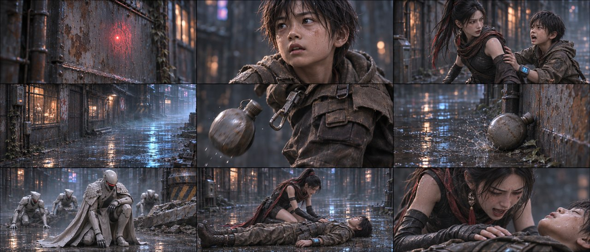
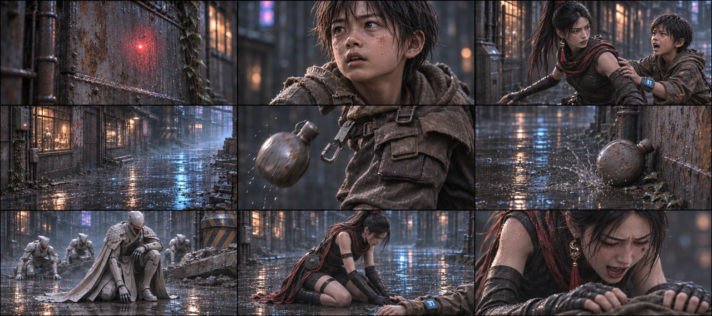
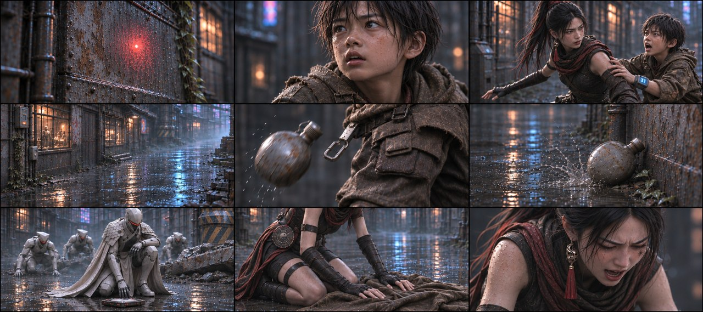
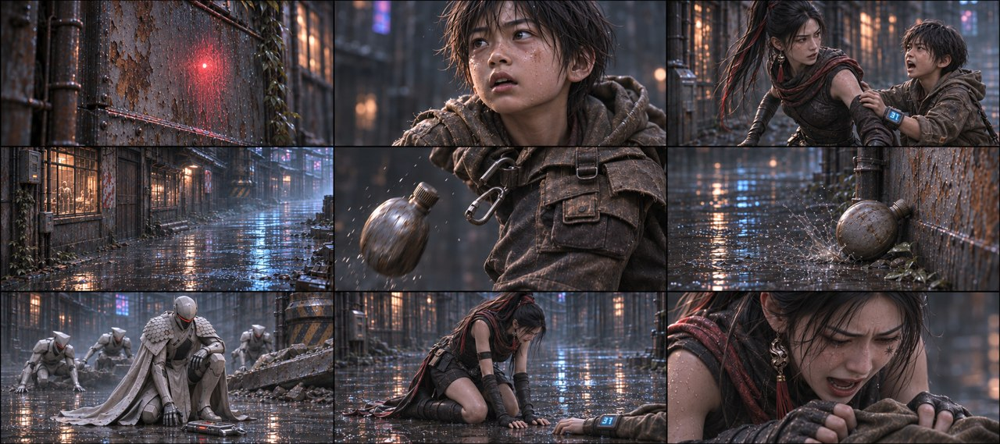
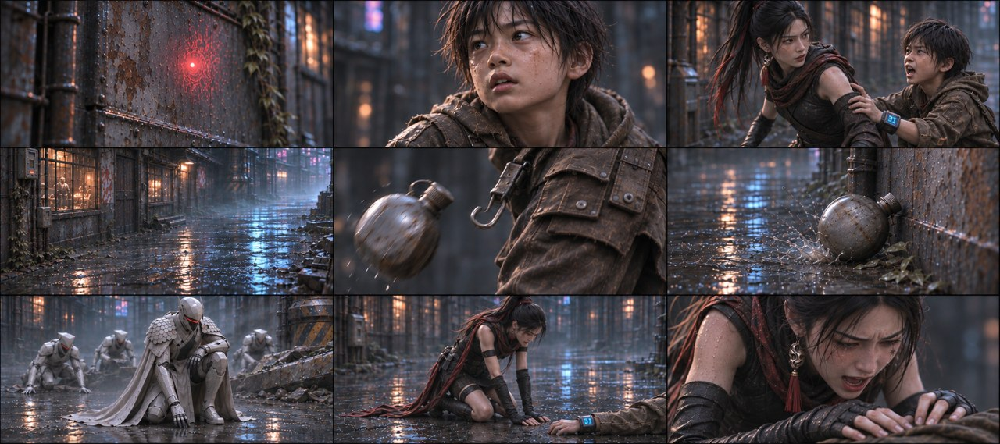

# B03-G04 · 石头救人与水壶坠落

5张完整九宫格，同组九格阅读顺序一致，均为审核稿。

[返回全部11组](../E01_ORIGINAL_V3_PREVIEW.md) · [下载所在独立包](https://github.com/liu-ai-cmd/LIU/raw/refs/heads/storyboard-downloads/E01_ORIGINAL_V3_B03B.zip)

|图号|机位候选|PNG原图|

|---|---|---|

|图01|正侧交代|[直接下载PNG](https://github.com/liu-ai-cmd/LIU/raw/refs/heads/storyboard-downloads/images/E01_ORIGINAL_V3/E01-B03-G04-I01.png)|

|图02|略低机位|[直接下载PNG](https://github.com/liu-ai-cmd/LIU/raw/refs/heads/storyboard-downloads/images/E01_ORIGINAL_V3/E01-B03-G04-I02.png)|

|图03|斜俯观察|[直接下载PNG](https://github.com/liu-ai-cmd/LIU/raw/refs/heads/storyboard-downloads/images/E01_ORIGINAL_V3/E01-B03-G04-I03.png)|

|图04|过肩反应|[直接下载PNG](https://github.com/liu-ai-cmd/LIU/raw/refs/heads/storyboard-downloads/images/E01_ORIGINAL_V3/E01-B03-G04-I04.png)|

|图05|远近对照|[直接下载PNG](https://github.com/liu-ai-cmd/LIU/raw/refs/heads/storyboard-downloads/images/E01_ORIGINAL_V3/E01-B03-G04-I05.png)|

## 图01 · 正侧交代

九格已目视，红信号空墙、石头表情、扶袖让开、空墙蓝反光、脱壶、滚壶、队长半跪、石头平躺/玄初跪旁、隔衣按扶完整。人物身上瞄准点、射线接触及举枪被转述，伤口未画。石头头背和双腿贴地。1916×821接近21:9。

## 图02 · 略低机位

九格已目视，红墙信号、石头表情、扶袖、蓝墙反光、水壶脱扣/滚墙、成人半跪、女主跪旁和按扶相接。后两格少年大部分在画外，仅褐袖及31可辨；不冒称已逐部位核查隐藏身体。主体伤亡采用反应转述。 本图1881×836，为近似21:9（约3.6%偏差），未拉伸或裁切PNG。

## 图03 · 斜俯观察

已目视九格：空墙信号、石头发现、拉袖提醒、空巷蓝光、同一水壶脱落与落地、成人队长在地面装置旁、玄初双手按棕衣、玄初反应。第8/9格儿童身体画外，通过局部与成人反应表达救助结果；原文保留。

## 图04 · 过肩反应

九格已目视，红墙信号、少年表情、扶袖让开、蓝墙反光、脱壶/滚壶、成年队长半跪、女主跪下与隔衣按扶反应相接。末两格少年主体画外，仅袖/腕屏与褐布可辨，未据裁切宣称全身验证。 实际1881×836，为近似21:9；PNG未经拉伸或裁切。

## 图05 · 远近对照

九格已目视，红墙信号、少年表情、扶袖让开、蓝墙反光、脱壶/滚壶、成年队长半跪、女主跪下与隔衣按扶反应相接。末两格少年主体画外，仅袖/腕屏与褐布可辨，未据裁切宣称全身验证。 实际1881×836，为近似21:9；PNG未经拉伸或裁切。

## 九格剧情顺序

### 全剧073 · 红色瞄准点

玄初胸前衣甲局部出现小红点，整片护甲完整，不画射线接触过程，石头在画外。

### 全剧074 · 石头察觉

石头瞳孔与眼神近景，看向玄初胸前红点方向，蓝31只在需要时处画外，不乱加腕屏。

### 全剧075 · 推开玄初

石头双手把玄初推向自己左侧，成人玄初重心向侧方让开，两人接触明确；本格不出现枪或射线。

### 全剧076 · 空巷蓝光

只拍尘雾中的一条蓝色光线越过空巷，画面没有人，也没有血花或接触。

### 全剧077 · 水壶脱扣

唯一铁皮水壶从石头腰带扣环脱出，取扣环和落壶的物件局部，衣物完整。

### 全剧078 · 水壶滚墙

同一只水壶沿湿地滚到固定墙根，墙面和泥水给明确落点，器械和人物均画外。

### 全剧079 · 队长架稳

前方尘影里的成年队长半跪架稳设备，面向一段空巷，三名短甲成人在倒柱残迹后起身；二位同伴不入本格。

### 全剧080 · 倒地与跪旁

过渡后的结果：石头平躺湿地、头背贴地，双腿平放，衣物完整；玄初落膝跪到其身旁，不能把石头画成坐姿或站姿。

### 全剧081 · 玄初按扶

玄初双手隔完整褐衣按扶同伴上身并低头喊话，石头维持平躺；不画伤口或外露组织，依表情和落壶转述悲剧。

展开该组完整原文

石头抬头瞥见玄初胸口的红色瞄准点，瞳孔骤缩，猛地用尽全力将玄初撞向一侧！
石头（嘶吼）：小心——！
灰尘里突然射出一道蓝色激光。
噗嗤！粗大的高频射线迎面贯穿石头胸口，爆出一大片血花。那只铁皮水壶从他身上甩出，当啷滚落在血泥里，镜头追着水壶滚到墙根。
正前方巷口沙尘阴影里，执行官队长早已半跪架起双手重型能量枪（另外还爬起3个执行官，地上是柱子B的崩塌痕迹和其余被砸毁的执行官残骸）。
石头仰面重重倒在泥血里，血在冷光里发暗。玄初扑跪过去，双手死死按住他胸口喷血的血洞，鲜血从她指缝里涌出来。
玄初（双手剧烈颤抖，失声）：石头！石头！

