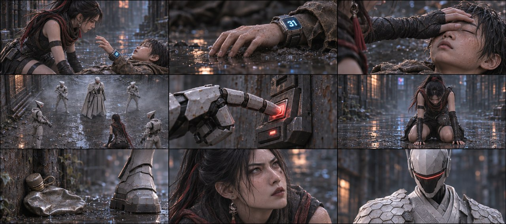
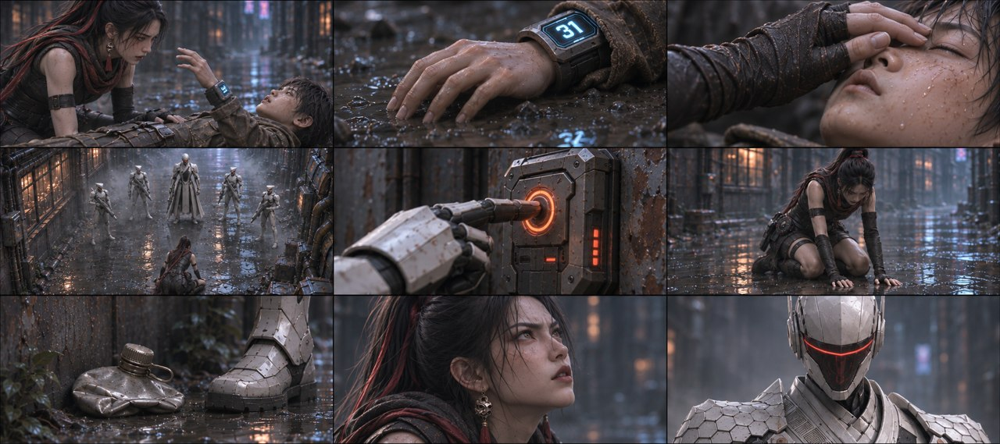
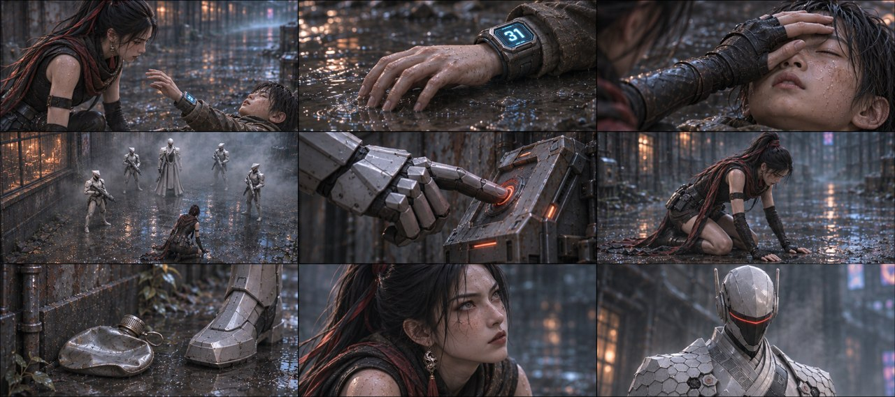
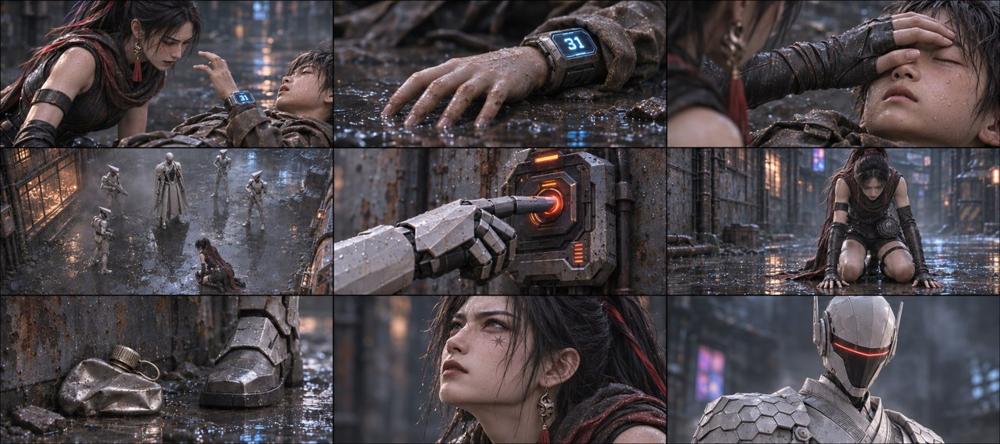
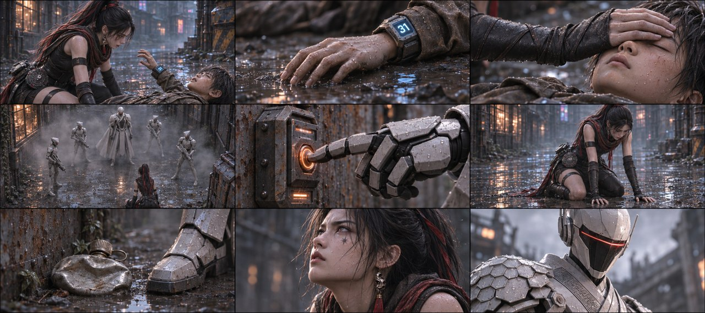

# B03-G05 · 最后告别与包围压制

5张完整九宫格，同组九格阅读顺序一致，均为审核稿。

[返回全部11组](../E01_ORIGINAL_V3_PREVIEW.md) · [下载所在独立包](https://github.com/liu-ai-cmd/LIU/raw/refs/heads/storyboard-downloads/E01_ORIGINAL_V3_B03B.zip)

|图号|机位候选|PNG原图|

|---|---|---|

|图01|正侧交代|[直接下载PNG](https://github.com/liu-ai-cmd/LIU/raw/refs/heads/storyboard-downloads/images/E01_ORIGINAL_V3/E01-B03-G05-I01.png)|

|图02|略低机位|[直接下载PNG](https://github.com/liu-ai-cmd/LIU/raw/refs/heads/storyboard-downloads/images/E01_ORIGINAL_V3/E01-B03-G05-I02.png)|

|图03|斜俯观察|[直接下载PNG](https://github.com/liu-ai-cmd/LIU/raw/refs/heads/storyboard-downloads/images/E01_ORIGINAL_V3/E01-B03-G05-I03.png)|

|图04|过肩反应|[直接下载PNG](https://github.com/liu-ai-cmd/LIU/raw/refs/heads/storyboard-downloads/images/E01_ORIGINAL_V3/E01-B03-G05-I04.png)|

|图05|远近对照|[直接下载PNG](https://github.com/liu-ai-cmd/LIU/raw/refs/heads/storyboard-downloads/images/E01_ORIGINAL_V3/E01-B03-G05-I05.png)|

## 图01 · 正侧交代

九格已目视：末语抬手、手落、合眼、队长+4白短甲围住女主、设备按键、既定跪撑、已扁水壶、女主仰眼、队长命令。第1格少年为仰卧抬头相位，下半身画外，不能声称头背始终贴地；之后不再活动入画。压制、踩壶和近额枪口采用既定结果/反应转述。 本图1881×836，为近似21:9（约3.6%偏差），未拉伸或裁切PNG。

## 图02 · 略低机位

九格已目视，末语抬手、手落、合眼、五名白甲围住女主、设备按键、跪撑、扁壶、女主眼神和队长口令相接。首格少年取仰卧抬头相位，下半身画外；合眼后不再活动入画。原文压制/踩壶/近眉心枪口以结果和反应转述。 实际1881×836，为近似21:9；PNG未经拉伸或裁切。

## 图03 · 斜俯观察

九格已目视，末语抬手、手落、合眼、五名白甲围住女主、设备按键、跪撑、扁壶、女主眼神和队长口令相接。首格少年取仰卧抬头相位，下半身画外；合眼后不再活动入画。原文压制/踩壶/近眉心枪口以结果和反应转述。 实际1881×836，为近似21:9；PNG未经拉伸或裁切。

## 图04 · 过肩反应

九格已目视，末语抬手、手落、合眼、五名白甲围住女主、设备按键、跪撑、扁壶、女主眼神和队长口令相接。首格少年取仰卧抬头相位，下半身画外；合眼后不再活动入画。原文压制/踩壶/近眉心枪口以结果和反应转述。 实际1881×836，为近似21:9；PNG未经拉伸或裁切。

## 图05 · 远近对照

九格已目视，末语抬手、手落、合眼、五名白甲围住女主、设备按键、跪撑、扁壶、女主眼神和队长口令相接。首格少年取仰卧抬头相位，下半身画外；合眼后不再活动入画。原文压制/踩壶/近眉心枪口以结果和反应转述。 实际1881×836，为近似21:9；PNG未经拉伸或裁切。

## 九格剧情顺序

### 全剧082 · 石头最后低语

石头保持仰躺，一只手缓缓抬向玄初，面部安静，褐衣完整；玄初侧边跪姿不变。

### 全剧083 · 手落泥面

石头抬起的同一只手垂落到湿泥，蓝31腕屏保留，取手指与泥面接触的静态相位。

### 全剧084 · 玄初合眼

玄初自己的右手缓缓合上平躺同伴双眼，只见手与平躺脸部，另一只手不增加。石头此后保持闭眼和地面姿态。

### 全剧085 · 五人落位

队长加四名短甲成人从尘雾中落到约5米外形成包围，玄初在原地跪着，石头在画外；四名短甲中的第四名来自尘雾，非新生复制角色。

### 全剧086 · 压制弹离口

只拍一名成年执行官的设备和动能弹离口，背景空巷，所有被作用人物在画外。

### 全剧087 · 双膝撑地

玄初双膝落在泥地，自己的双手在前撑住，衣物与四肢完整；设备与石头都在画外。

### 全剧088 · 水壶被踩扁

成年队长金属靴压扁墙根原来那只水壶，地面没有人体，壶形从圆扁变化可读。

### 全剧089 · 枪口近眉心

只画成年玄初侧面和队长手持科幻器械停在她额前近处，衣物完整、没有开火或伤害形成，女主仍跪姿。

### 全剧090 · 执行命令

队长面罩独立近景，语气机械冷漠，玄初、石头和器械目标都在画外，动作停在命令完成。

展开该组完整原文

石头：（嘴里涌出鲜血，颤抖着抬手伸向玄初）快跑……
石头的手悬在半空，无力垂落在血水里。镜头贴着他的手指，从半空落到泥面。
玄初伸出沾满鲜血的手，缓缓合上石头的双眼。侧光只照住她那只手。
逆光里一排影子从灰尘中跳出压下来，围绕玄初周围（间隔5米左右）落下，4名执行官与执行官队长（共5个）前后包抄，围住玄初。一名执行官射出动能压制弹，震荡波轰然炸开，把玄初压得双膝砸进泥地，双手死死撑地。
执行官队长走上前，咔嚓一脚把地上那只染血的铁皮水壶踩扁，枪口顶住玄初额头。镜头压在泥地上，水壶的变形和他靴底在同一个画面里。
执行官队长：（机械音）压制完成。执行清除。

