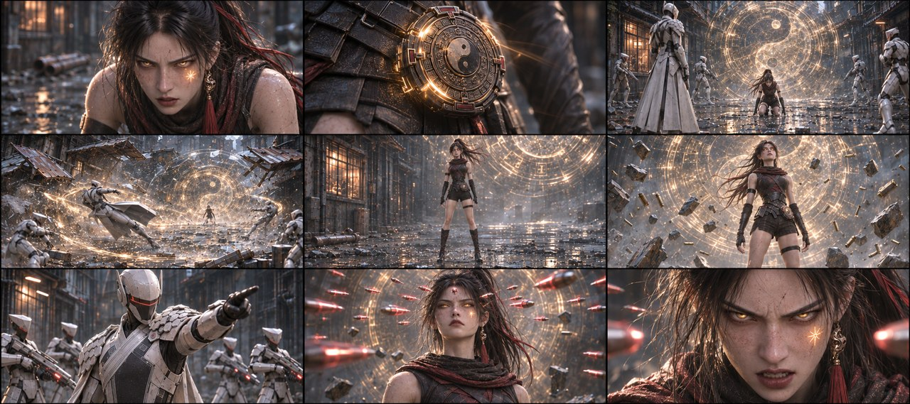
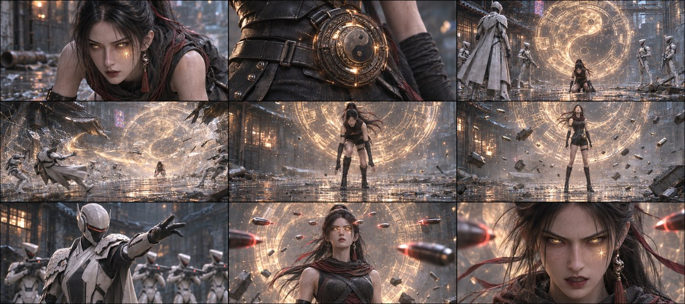
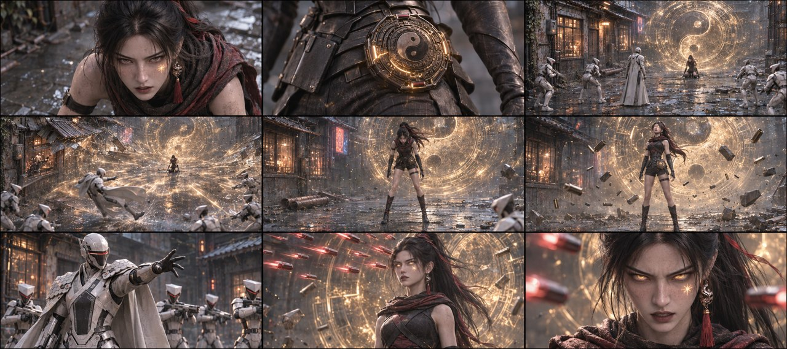
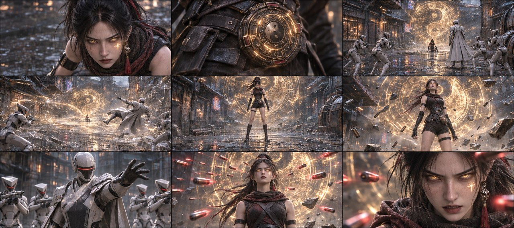
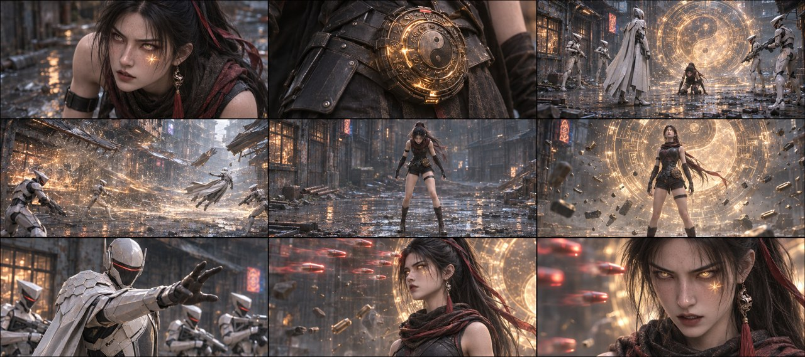

# B03-G06 · 玄衡觉醒与弹丸悬停

5张完整九宫格，同组九格阅读顺序一致，均为审核稿。

[返回全部11组](../E01_ORIGINAL_V3_PREVIEW.md) · [下载所在独立包](https://github.com/liu-ai-cmd/LIU/raw/refs/heads/storyboard-downloads/E01_ORIGINAL_V3_B03B.zip)

|图号|机位候选|PNG原图|

|---|---|---|

|图01|正侧交代|[直接下载PNG](https://github.com/liu-ai-cmd/LIU/raw/refs/heads/storyboard-downloads/images/E01_ORIGINAL_V3/E01-B03-G06-I01.png)|

|图02|略低机位|[直接下载PNG](https://github.com/liu-ai-cmd/LIU/raw/refs/heads/storyboard-downloads/images/E01_ORIGINAL_V3/E01-B03-G06-I02.png)|

|图03|斜俯观察|[直接下载PNG](https://github.com/liu-ai-cmd/LIU/raw/refs/heads/storyboard-downloads/images/E01_ORIGINAL_V3/E01-B03-G06-I03.png)|

|图04|过肩反应|[直接下载PNG](https://github.com/liu-ai-cmd/LIU/raw/refs/heads/storyboard-downloads/images/E01_ORIGINAL_V3/E01-B03-G06-I04.png)|

|图05|远近对照|[直接下载PNG](https://github.com/liu-ai-cmd/LIU/raw/refs/heads/storyboard-downloads/images/E01_ORIGINAL_V3/E01-B03-G06-I05.png)|

## 图01 · 正侧交代

编辑后九格已目视，第5格双腿伸直站稳、双手离地；巨青铜盘、金光气浪、碎物与悬停弹丸状态延续。石头本组全在画外，未复活；大远景人数不可精确验收。1881×836，约3.6%比例偏差。

## 图02 · 略低机位

九格已目视，女主第5格取半起身相位，第6格双脚着地站直，金瞳、碎物、巨盘与弹丸相接；石头均画外。实际图并非第5格已完全站直，图文差异已记录。

## 图03 · 斜俯观察

九格已目视：星痕、小坠、巨盘、金光气浪、起身相位、站立浮物、成人命令、弹丸停住、女主低吼。第5格上身微俯、第6格完全站立，石头全在画外；远景人数不作逐人验收。 本图1881×836，为近似21:9（约3.6%偏差），未拉伸或裁切PNG。

## 图04 · 过肩反应

九格已目视，星痕、小坠、巨盘、气浪、起身、站直浮物、成人下令、弹丸停住与低吼相接。第6格为完整站立，石头本组始终画外，远景人数不作精确验收。 实际1881×836，为近似21:9；PNG未经拉伸或裁切。

## 图05 · 远近对照

九格已目视，星痕、小坠、巨盘、气浪、起身、站直浮物、成人下令、弹丸停住与低吼相接。第6格为完整站立，石头本组始终画外，远景人数不作精确验收。 实际1881×836，为近似21:9；PNG未经拉伸或裁切。 第5格仍为上身前俯的半起相位，至第6格站直。

## 九格剧情顺序

### 全剧091 · 星痕亮起

玄初仍跪着抬眼，人物自身左眼下星痕发出金光，取额头与眼部，脸部完整，用光和表情表达觉醒。

### 全剧092 · 青铜坠震鸣

腰间小青铜玄衡阴阳圆盘近景，缝隙漏出金光、轮廓带轻微震动感；不是钟表、龙或虎。

### 全剧093 · 巨盘展开

以女主成年跪姿为尺度，巨大半透明粒子青铜阴阳圆盘在她背后展开；队长器械的扣动仅作为画外声音，不在本格增加近身打击。

### 全剧094 · 气浪破场

金色气浪扫过空巷，掀起两侧铁棚并碎开透明压制场；成年白披甲队长被推离原位置。倒柱残迹在地面，石头不入画。

### 全剧095 · 玄初站起

女主从双手撑地后收脚移重心，画关键完成相位：双脚踏稳、双膝已直、双手离地。用全身中景确证站立，不能继续跪着。

### 全剧096 · 碎物悬浮

女主已站直，双眼金光，前景碎铁、弹壳、石块离地，巨盘持续在背后；脸部衣物完整，不恢复压制场。

### 全剧097 · 队长下令

成年队长已从地面起身，在外圈向四名短甲下令，石头和玄初均在本格画外，队长仍唯一白长披甲。

### 全剧098 · 弹丸静止

成年玄初保持直立，密集红色电磁弹丸停在她额前一寸空间，金色巨盘和悬浮碎物保留；没有弹丸接触皮肤。

### 全剧099 · 玄初低吼

取站立玄初的金瞳与脸部近景，缓缓抬头锁住前方成人执行官，眼神凶厉而克制；前景少量悬停弹丸，不出现石头。

展开该组完整原文

玄初艰难地抬起头。左眼下的星形胎记骤然爆出刺目的金光，把她半张脸照亮。
嗡——！腰间的青铜玄衡爆发出剧烈震动的金属长鸣，金光从盘面缝里漏出来。
执行官队长扣下扳机的瞬间，一面巨大的半透明粒子状青铜玄衡虚影在玄初背后轰然展开。
轰！金光把整条巷道照白一瞬——狂暴的气浪直接掀翻两侧铁棚，压制力场瞬间粉碎，执行官队长整个人被气浪掀飞倒退数米。
玄初双手撑地缓缓站起，双眼亮起暴戾的金色流光，两行刺目的鲜血同时从她眼角与鼻腔溢出。整条巷道的碎石、弹壳、废铁同时离地悬浮，镜头从地面拉起，穿过悬停的碎铁。
执行官队长：（站起，惊怒厉喝）压制失效！实弹开火！
七名执行官同时扣动扳机。上百发电磁子弹密集射来，却在距离玄初眉心一寸处全部悬停，剧烈震颤，画面里全是停住的红色光点。
镜头贴近她沾血的脸。玄初缓缓抬头，金色瞳孔死死锁住前方全队。
玄初：（野兽般的低吼）你们……都该死！
【第1集 完】

