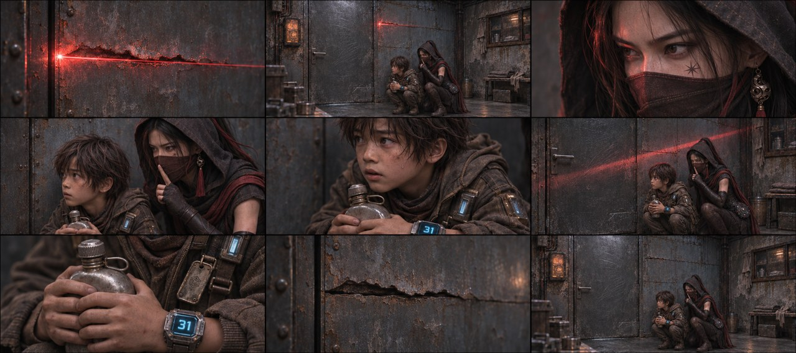

# 第一集｜原始九宫格方式 V3

制作中：本次按原提示词架构自行识别剧本，11组×每组5张，计划55张；本页目前仅发布首张实际样图，不代表55张已完成。

## B01-G01 图01｜裂缝扫描与屋内藏身

[下载此张PNG](https://github.com/liu-ai-cmd/LIU/raw/refs/heads/storyboard-downloads/images/E01_ORIGINAL_V3/E01-B01-G01-I01.png)

[查看本张实际提示词](E01_ORIGINAL_V3_PROMPT_SAMPLE.md)

九格已目视，藏身、眼神、抱壶、光退与阴暗结束完整。原文捂嘴已明确转述为成人对自己作安静手势，二人不接触；实际图中下身主要由外披遮挡。1881×836，约3.6%画幅偏差；不可辨胸牌细字不作验收。
