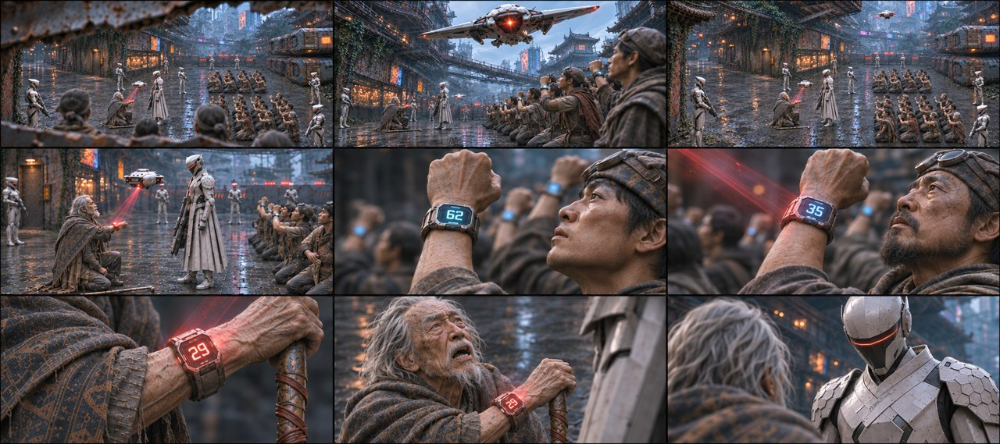
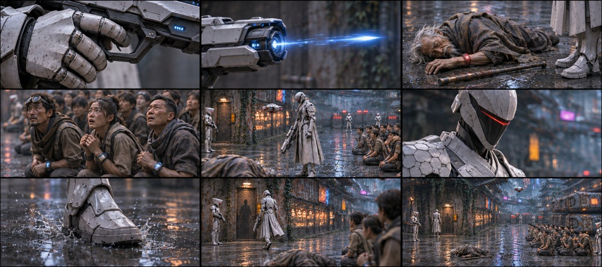
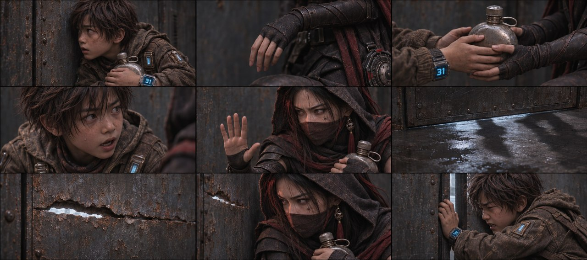
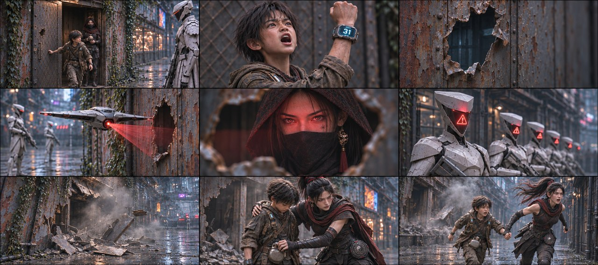
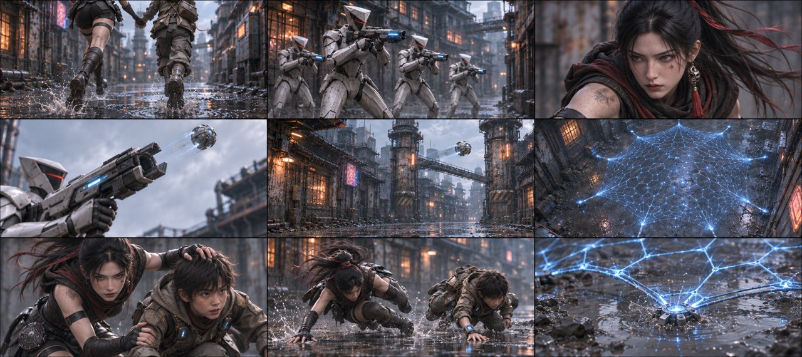
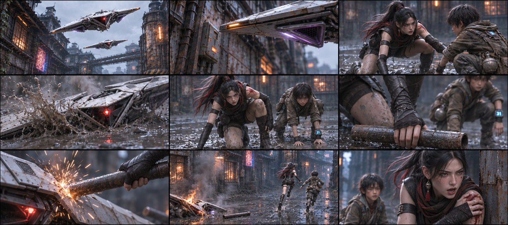
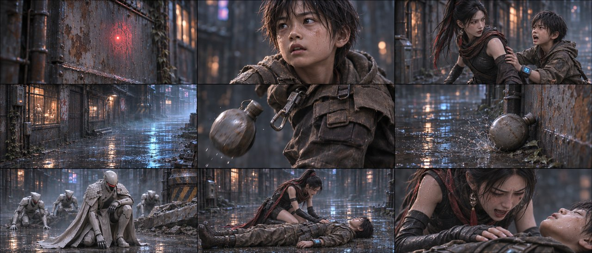
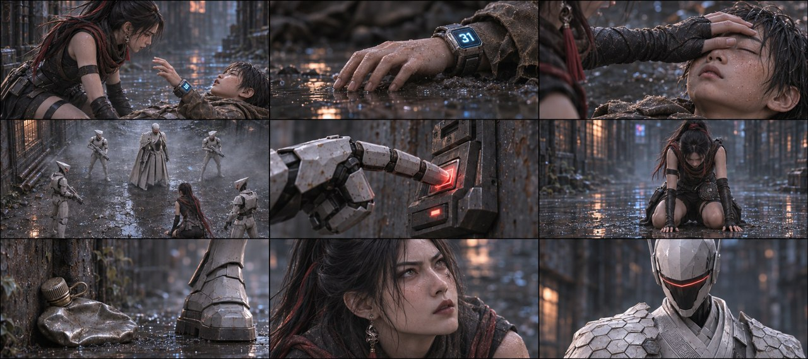
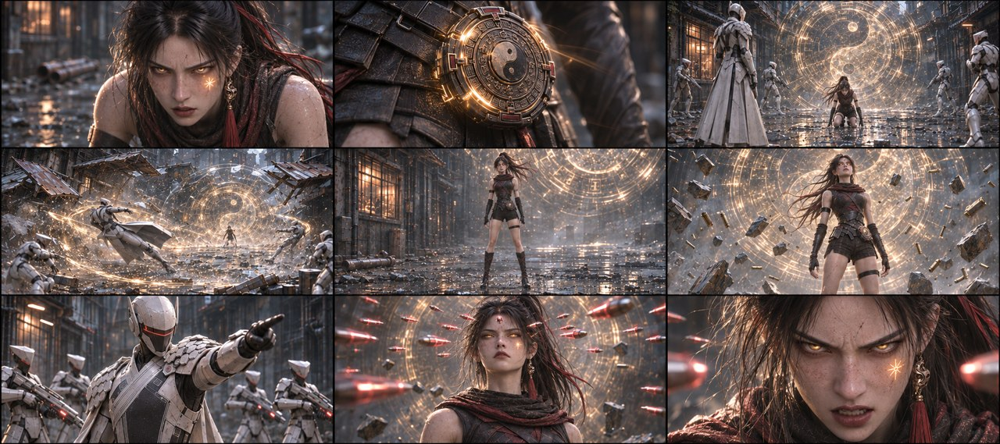

# 第一集｜原始九宫格方式 V3

**制作中：目前已生成并目视检查24/55张。** 目标11组、每组5张完整九宫格，不分导演版本。各组实际可下载数量如下，不把未完成项算作成品。

[查看原提示词架构样本](E01_ORIGINAL_V3_PROMPT_SAMPLE.md)

## B01-G01 · 裂缝扫描与屋内藏身 · 当前2/5张

[打开本组当前候选与PNG下载](E01_ORIGINAL_V3_GROUPS/B01-G01.md)

## B02-G01 · 封巷扫描与红色29 · 当前3/5张

[打开本组当前候选与PNG下载](E01_ORIGINAL_V3_GROUPS/B02-G01.md)

## B02-G02 · 老者倒地与队长逼近 · 当前3/5张

[打开本组当前候选与PNG下载](E01_ORIGINAL_V3_GROUPS/B02-G02.md)

## B01-G02 · 递水壶与破门危机 · 当前1/5张

[打开本组当前候选与PNG下载](E01_ORIGINAL_V3_GROUPS/B01-G02.md)

## B02-G03 · 石头出门与漏洞暴露 · 当前1/5张

[打开本组当前候选与PNG下载](E01_ORIGINAL_V3_GROUPS/B02-G03.md)

## B03-G01 · 奔逃与电网迫近 · 当前2/5张

[打开本组当前候选与PNG下载](E01_ORIGINAL_V3_GROUPS/B03-G01.md)

## B03-G02 · 躲开机翼与铁管反击 · 当前3/5张

[打开本组当前候选与PNG下载](E01_ORIGINAL_V3_GROUPS/B03-G02.md)

## B03-G03 · 倒柱封路与极限滑行 · 当前3/5张

[打开本组当前候选与PNG下载](E01_ORIGINAL_V3_GROUPS/B03-G03.md)

## B03-G04 · 石头救人与水壶坠落 · 当前2/5张

[打开本组当前候选与PNG下载](E01_ORIGINAL_V3_GROUPS/B03-G04.md)

## B03-G05 · 最后告别与包围压制 · 当前1/5张

[打开本组当前候选与PNG下载](E01_ORIGINAL_V3_GROUPS/B03-G05.md)

## B03-G06 · 玄衡觉醒与弹丸悬停 · 当前3/5张

[打开本组当前候选与PNG下载](E01_ORIGINAL_V3_GROUPS/B03-G06.md)
